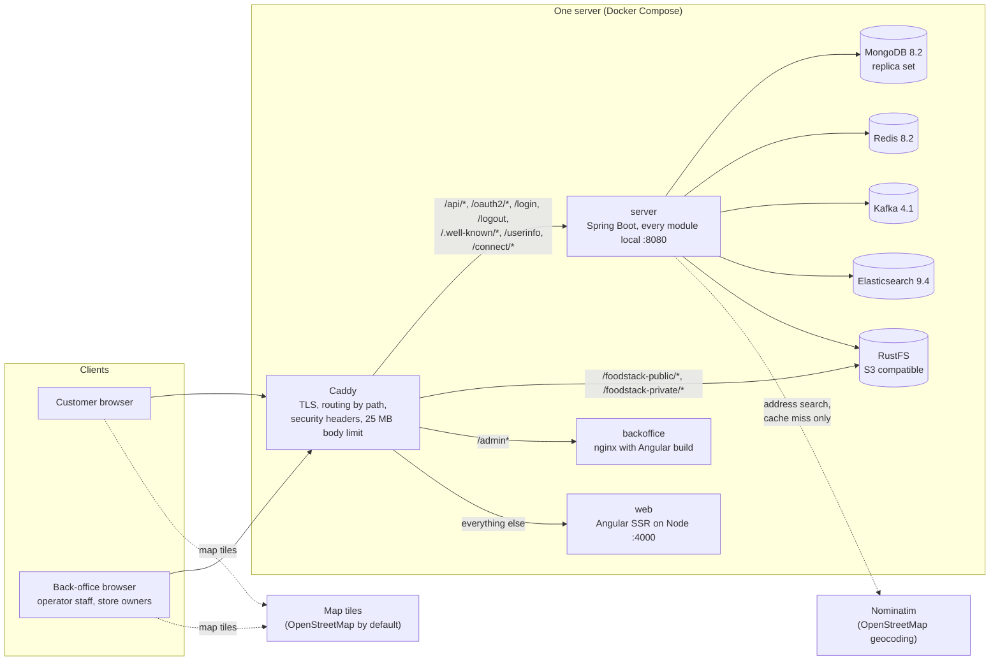
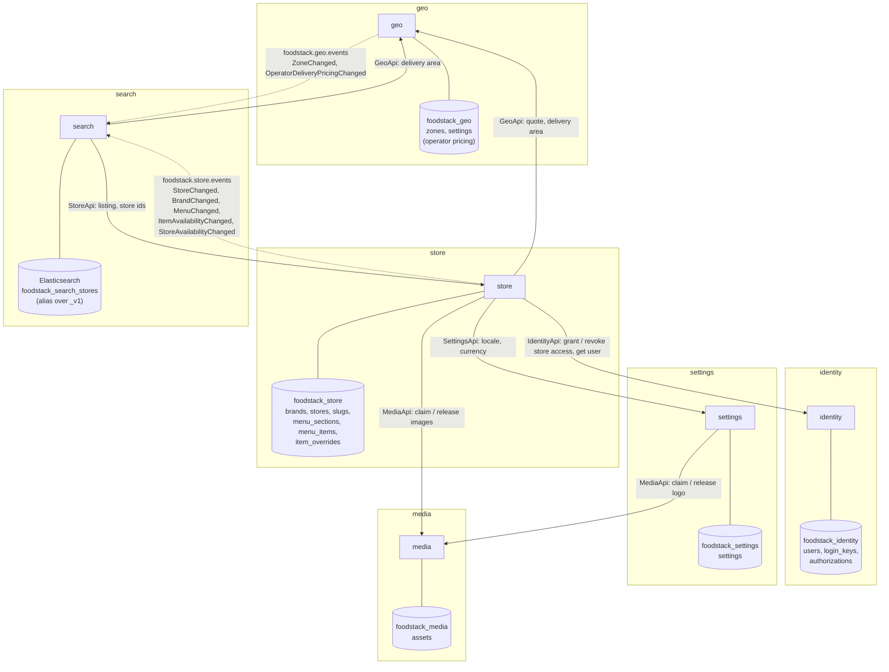
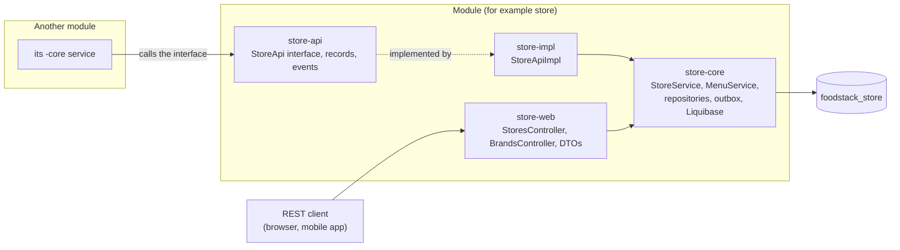

# 1. Big picture

[Back to index](README.md)

## 1.1 What runs where (single server, the unit deployer)

This is what `install.sh` starts today (`deploy/unit-deployer/src/main/dist/docker-compose.yml`). The Kubernetes chart is planned for M5 and does not exist yet.

- The browser apps call the API on the same origin, so there is no CORS between the apps and the server.
- Images are served straight from object storage through Caddy, never through the Java server.
- The server's internal Module-Switch port is not used in this topology: every module is `local` in one JVM.

## 1.2 Modules, their data, and who calls whom

Solid arrows are **synchronous calls** through another module's `-api` interface (an in-process Java call in the monolith, an HTTP call to the internal port when modules are split). Dashed arrows are **Kafka events**.

Every module also has its own `<module>_outbox`, `<module>_inbox` and Liquibase tracking collections in its database. `search` keeps no MongoDB database at all: its index can always be rebuilt from `store` and `geo`.

### Events with no consumer yet

These are published to Kafka today but nothing reads them. They are there for the modules that come in M2 and later (for example `notification`).

| Topic | Events |
|---|---|
| `foodstack.identity.events` | `UserRegistered`, `UserTokensRevoked` |
| `foodstack.settings.events` | `SettingsChanged` |
| `foodstack.media.events` | `MediaReady` |

## 1.3 Inside one module

Every module has the same four parts. Only `-impl` and `-web` are entry points; both call the same `-core` services, so no rule is written twice.

- Permission checks live in `-web` (`@PreAuthorize`, `CurrentUser.requireStoreAccess`). `-impl` runs none; see [Code vs design](05-code-vs-design.md).
- Where a module is `http` or `off`, its `-core`, `-impl` and `-web` beans are not created; another module that needs it gets a Module-Switch HTTP client for its `-api` instead.
