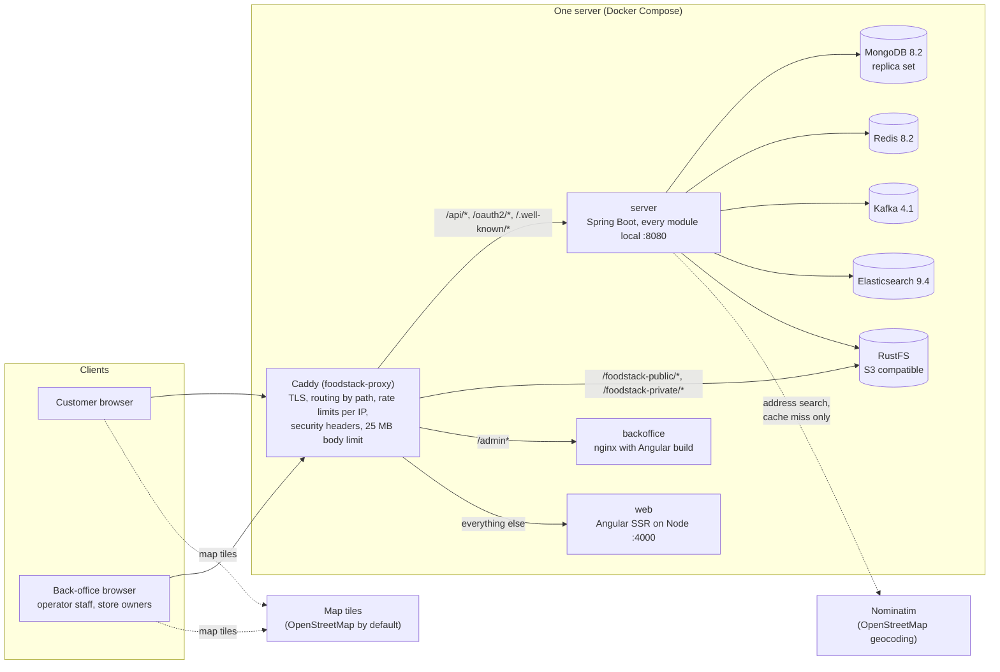
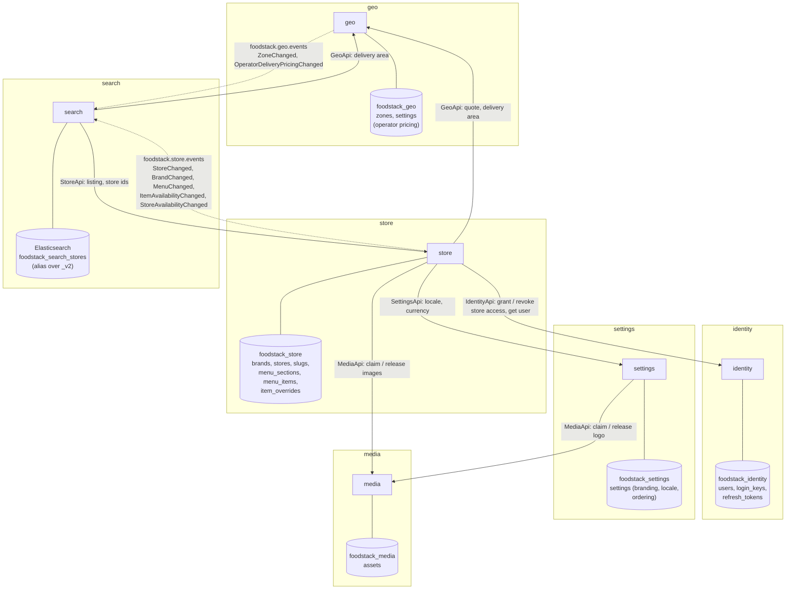
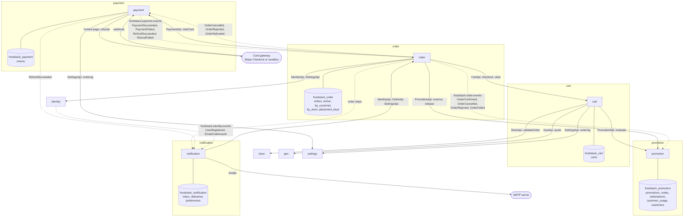
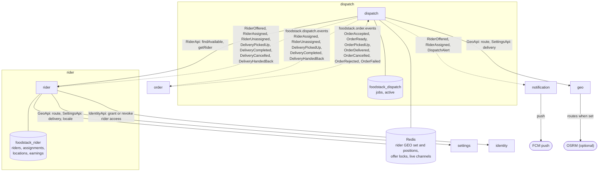
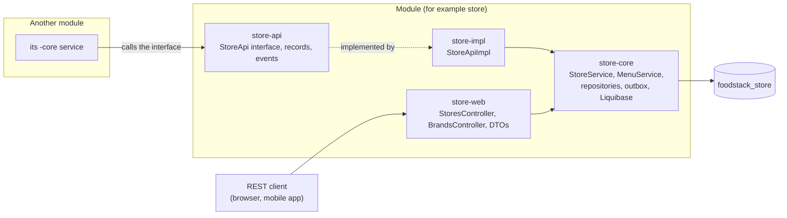

# 1. Big picture

[Back to index](README.md)

## 1.1 What runs where (single server, the unit deployer)

This is what `install.sh` starts today (`deploy/unit-deployer/src/main/dist/docker-compose.yml`). The Kubernetes chart is planned for M5 and does not exist yet.

- The browser apps call the API on the same origin, so there is no CORS between the apps and the server.
- Images are served straight from object storage through Caddy, never through the Java server.
- The server's internal Module-Switch port is not used in this topology: every module is `local` in one JVM.
- The same code runs on many machines: see [8. How FoodStack scales out](08-scaling.md) for the scaled-out picture and the growth stages.

## 1.2 Modules, their data, and who calls whom

Solid arrows are **synchronous calls** through another module's `-api` interface (an in-process Java call in the monolith, an HTTP call to the internal port when modules are split). Dashed arrows are **Kafka events**.

**Ordering modules (M2).** The catalogue modules they call are drawn as plain boxes; their databases are in the diagram above.

Every module also has its own `<module>_outbox`, `<module>_inbox` and Liquibase tracking collections in its database, and every collection name starts with the module name (`order_orders`, `cart_carts`). `search` keeps no MongoDB database at all: its index can always be rebuilt from `store` and `geo`. `order` also reads its own events to keep the order lists (`order_by_customer`, `order_by_store`) up to date. `order` calls `SettingsApi` as well as `IdentityApi`, and `notification` calls all three of `IdentityApi`, `OrderApi` and `SettingsApi`; each is drawn as one arrow to keep the diagram readable. The flows of the ordering modules are on [6. Ordering flows](06-ordering-flows.md).

**Delivery modules (M3).** `rider` keeps rider accounts, where riders are and what they earned; `dispatch` keeps one job per delivery order and finds riders. The flows are on [7. Delivery flows](07-delivery-flows.md).

`dispatch` calls `GeoApi` and `SettingsApi`, and `rider` calls both too; each pair is drawn as one arrow. `rider` publishes `RiderStatusChanged` on `foodstack.rider.events`, which nothing reads yet.

### Events with no consumer yet

These are published to Kafka today but nothing reads them yet.

| Topic | Events | Expected reader |
|---|---|---|
| `foodstack.identity.events` | `UserTokensRevoked` | Gateway token cache (M5) |
| `foodstack.settings.events` | `SettingsChanged` | Caches in other replicas |
| `foodstack.media.events` | `MediaReady` | — |
| `foodstack.promotion.events` | `CouponRedeemed`, `CouponReleased` | Reports and ledger (M4) |
| `foodstack.order.events` | `OrderPlaced`, `OrderPreparing`, `OrderCollected` (read only by order's own projections) | Ledger (M4) |
| `foodstack.rider.events` | `RiderStatusChanged` | Reports (M4) |

## 1.3 Inside one module

Every module has the same four parts. Only `-impl` and `-web` are entry points; both call the same `-core` services, so no rule is written twice.

- Permission checks run at both entry points. `-web` uses `@PreAuthorize` and `CurrentUser.requireStoreAccess`. `-impl` uses `ModuleAccess` (`requireAuthenticated`, `requireServiceOr`, `requireServiceSelfOr`), so a module answers another module only what the user behind the call could ask for. Background work (event listeners, sweeps, rebuilds, demo seeding) runs as the platform through `ServiceCalls` with a service token (`module:service`).
- Where a module is `http` or `off`, its `-core`, `-impl` and `-web` beans are not created; another module that needs it gets a Module-Switch HTTP client for its `-api` instead.
