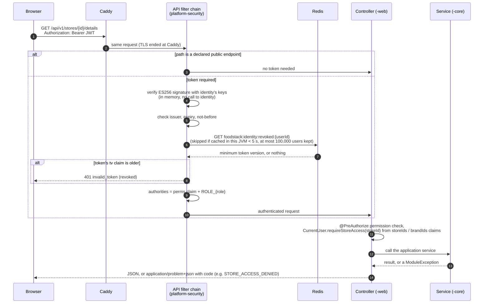
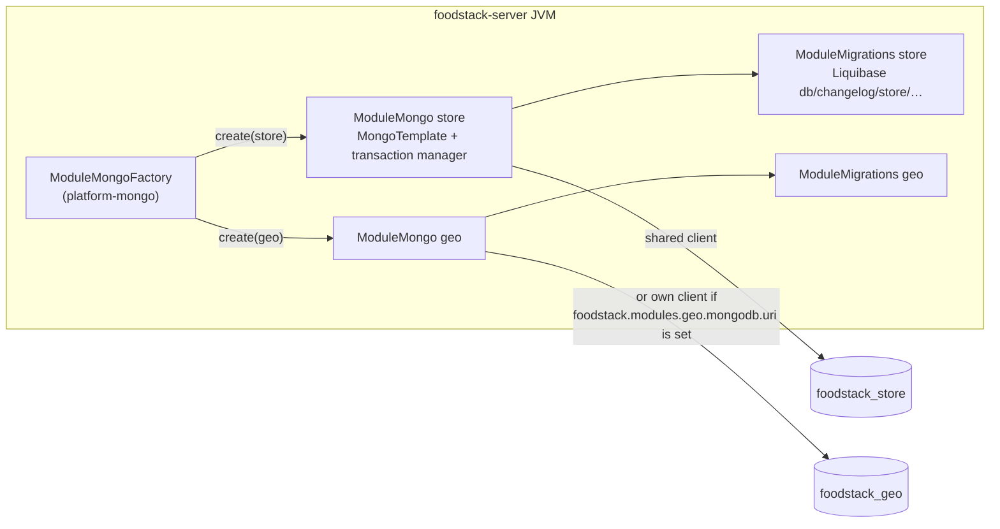
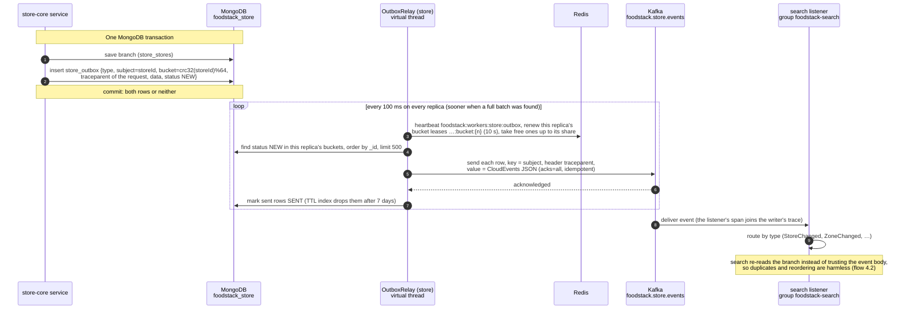
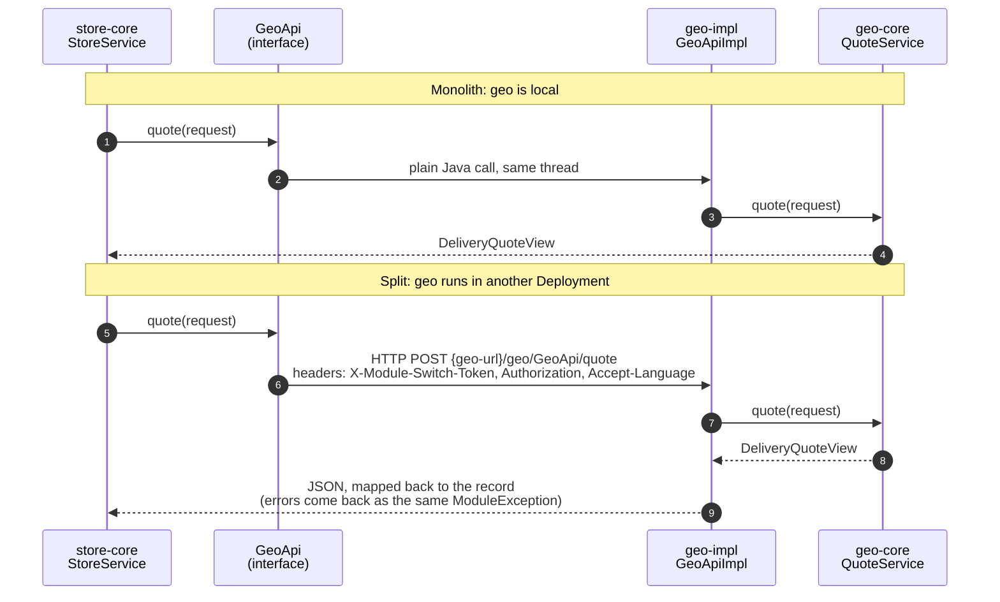

# 2. Platform mechanics

[Back to index](README.md)

The machinery every module shares. Code lives in `platform/` (`platform-security`, `platform-mongo`, `platform-kafka`, `platform-web`).

## 2.1 What happens to every request

Spring Security picks the first filter chain whose path matches. The chains, in order:

| Order | Chain | Paths | Rule |
|---|---|---|---|
| 1 | Token keys and service token (`identity-web`) | `/oauth2/**`, `/.well-known/**` | Spring Authorization Server, kept only for the public keys (JWKS), its metadata and the client-credentials service token of split deployments. Stateless: no login page, no session |
| 10 | API (`platform-security`) | `/api/**` | Stateless JWT resource server. Endpoints a module declares as `PublicEndpoints` are open; everything else needs a valid token |
| last | Default | everything else | Only `/actuator/health/**`, `/actuator/info` and `/error` are open; the rest is denied |

- **Where the signing keys come from.** In the JVM that runs `identity`, the decoder reads the keys straight from `identity`'s `JWKSource` bean. In any other JVM (split topology) it downloads them once from `/oauth2/jwks` and caches them.
- **Revocation.** `identity` raises the user's `tokenVersion` (for example on "sign out everywhere"), writes the new minimum to Redis and also publishes `UserTokensRevoked`. Other modules read Redis, not the event. Each JVM caches the value for 5 seconds (`foodstack.security.revocation-cache-ttl`) in a bounded Caffeine cache (`foodstack.security.revocation-cache-max-users`, default 100,000), so a revoked token can still pass for up to 5 seconds on a JVM that just checked it, and a busy JVM's memory stays flat however many users sign in. The user's refresh tokens stop working at once (the refresh checks the version too).
- **Signing in** is the stateless auth API, flow 4.1: no redirect, no server session.
- **Public API endpoints today** (each declared by its module's `-web` configuration): `GET /api/v1/search/stores`; `GET /api/v1/stores/{key}`, `/{key}/menu`, `/{key}/delivery-quote`; `GET /api/v1/settings/branding`, `/locale`; `GET /api/v1/geo/addresses`, `/addresses/reverse`, `/addresses/availability`; `POST /api/v1/auth/register`, `/login`, `/code`, `/reset`, `/refresh`. Everything else under `/api/**` needs a token (`POST /api/v1/auth/logout` too).

## 2.2 Each module gets its own database

- One MongoDB cluster, one database per module (`foodstack_<module>`), every collection prefixed with the module name.
- A module's Liquibase changelog runs at start-up, before the app takes traffic, only in the JVM where that module is `local`. Tracking collections are `<module>_databasechangelog` and `<module>_databasechangeloglock`.
- With `foodstack.mongodb.sharding.enabled=true`, the declared shard keys are applied after migration (CI runs this against a two-shard cluster).
- `--foodstack.migrate-only=true` runs every module's migrations and exits (used before an upgrade).

## 2.3 Events: outbox, relay, Kafka, consumer

- **Topics:** one per publishing module, `foodstack.<module>.events`, 24 partitions, 7-day retention, plus `.dlt` (30 days). They are created at start-up by each module's `KafkaAdmin.NewTopics` bean.
- **Ordering:** the key is the aggregate id, so events of one branch stay in order. If a send fails, only rows before the failure are marked sent; the failed row and the ones after it go again on the next poll.
- **Delivery guarantee:** at least once. Consumers whose handler is naturally idempotent skip the inbox: search re-reads the branch, order projections rebuild a row, notification keys every message by the event id, and payment uses the event id as the refund id. Consumers that change counters or state once per event (promotion's coupon counters, order's payment listener) record the event id in `<module>_inbox` in the same transaction.
- **Work buckets, not a leader:** every replica relays. Each outbox row carries `bucket = crc32(subject) % 64`, and the 64 buckets are split between the live replicas like a consumer group (`BucketLeases`): each takes up to `ceil(64 / replicas)` leases and gives back what is over its share when a replica joins; a dead replica's leases lapse and the others pick them up. One aggregate's events are always in one bucket, so they stay in order. The outbox is sharded on `{ bucket: 1, _id: 1 }`, so writes spread over every shard. The dispatch matcher and the accept-timeout sweep use the same buckets (TDD 7.3).
- **Tracing:** the outbox row keeps the W3C `traceparent` of the request that wrote it; the relay sends it as a Kafka header and in the CloudEvents envelope, and listeners (observation on) continue the same trace (TDD 7.4).
- **Concurrency:** each module's listeners run `foodstack.kafka.concurrency.<module>` threads (default `foodstack.kafka.listener-concurrency`, 3); replicas × threads above the partition count only leaves threads idle.
- **When a consumer fails:** `platform-kafka` retries 3 times with a growing pause (`foodstack.kafka.retry.*`), then `DeadLetters` publishes the record to `<topic>.dlt` with the error in its headers, so nothing is lost silently. Replaying from the `.dlt` topics has no screen yet.

## 2.4 What is in Redis

Every key starts with the namespace `foodstack`. Redis holds caches and coordination only; losing it loses no business data.

| Key | Written by | Value | Lifetime | Evicted when |
|---|---|---|---|---|
| `foodstack:settings:cache:branding`, `…:locale`, `…:ordering` | `settings` | Branding, locale or ordering JSON | 10 min (`foodstack.settings.cache-ttl`) | `settings` saves a change |
| `foodstack:store:menu:{storeId}:{generation}` and `foodstack:store:menu:gen:{storeId}` | `store` | The branch's effective menu (brand menu filtered by branch, with sold-out marks), under the branch's current generation number | 10 min (`foodstack.store.menu-cache-ttl`); the generation lives twice as long | A menu edit (all branches of the brand) or a sold-out change (that branch) raises the generation (`INCR`) right after the transaction commits, so a reader that loaded the old menu can never write it back under the new key |
| `foodstack:geo:cache:geocode:q:{lang}:{text}` and `…:r:{lang}:{lat}:{lng}` | `geo` | Address search or reverse geocode results (point rounded to about 11 m) | 7 days (`foodstack.geo.geocoding.cache-ttl`) | Never; expires |
| `foodstack:identity:revoked:{userId}` | `identity` | Lowest token version still valid | No expiry | Overwritten on the next revocation |
| `foodstack:identity:code:{LOGIN or PASSWORD_RESET}:{userId}` | `identity` | Hash of the 6-digit code and the tries left | 5 min | Deleted when used or after 5 wrong tries |
| `foodstack:{module}:rl:{scope}:{id}:{window}` | `identity` (codes per email), `cart` (coupon checks), `order` (placements) | Count in a fixed window | The window plus 1 s | Expires |
| `foodstack:order:rt:order:{orderId}`, `…:store:{storeId}` (pub/sub channels, not keys) | `order` | `{orderId, storeId, status, revision}` after each step | Not stored | — |
| `foodstack:rider:geo:{cell}` | `rider` | GEO set per map cell (0.25° grid) of operator riders who can take an offer now (online, active, free); a search reads the cells its circle touches | No expiry; a rider leaves it when busy, offline, suspended or moved to another cell | Every ping re-adds or removes the rider |
| `foodstack:rider:cell:{riderId}` | `rider` | The cell the rider was last put in, so a move removes them from the old set | 10 min | Overwritten on each ping |
| `foodstack:rider:pos:{riderId}` | `rider` | Last position and time of every online rider | 10 min | Overwritten on each ping |
| `foodstack:rider:rt:cell:{cell}`, `…:rt:order:{orderId}` (pub/sub channels) | `rider` | Position and busy flag after each ping, online state changes; live maps subscribe to the cells they show (at most 64) | Not stored | — |
| `foodstack:dispatch:offer:{riderId}` | `dispatch` | The order a rider has an open offer for (`SET NX`), so a rider never gets two offers at once | Offer timeout + 5 s | Deleted on accept, decline, expiry or hand-back |
| `foodstack:dispatch:rt:rider:{riderId}`, `…:rt:cell:{cell}` (pub/sub channels) | `dispatch` | `{orderId, status, riderId, kind}` after each job change, on the pickup's cell | Not stored | — |
| `foodstack:workers:{work}` and `…:{work}:bucket:{n}` | each publishing module (`{module}:outbox`), `dispatch` (`dispatch:matcher`), `order` (`order:accept-timeout`) | Live replicas (heartbeats) and the owner of each of the 64 work buckets | Lease 10 s (outbox), 15 s (matcher), 30 s (sweep), renewed while held | Released on shutdown; lapses when a replica dies |
| `foodstack:geo:cache:zones:{storeId}:{generation}`, `…:operator-pricing:{generation}` and their `:gen` keys | `geo` | A branch's zones, the operator's delivery pricing, for quotes | 10 min (`foodstack.geo.quote-cache-ttl`); generation twice as long | A change raises the generation after commit; `geo`'s own event listener does it again on every replica |
| `foodstack:search:rebuild` | `search` | Marks that one replica took this round of the daily re-read of every branch (`SET NX`) | 90% of the interval (`foodstack.search.rebuild-interval`, 24 h) | Expires, freeing the next round |

On Redis Cluster every command touches one key and live messages use sharded pub/sub (`SPUBLISH`/`SSUBSCRIBE`), so the same code runs on one Redis, Sentinel or a cluster; only `spring.data.redis.*` changes. Idempotency keys for placing an order are kept in MongoDB (`order_placement_keys`, inside the order's transaction) instead of Redis.

## 2.5 Module to module: monolith vs split

The same code runs in both shapes; only configuration (`module-switch.modules.<m>.mode`) changes.

- `Authorization` and `Accept-Language` are forwarded (`module-switch.propagate-headers`), and the called module authenticates the forwarded token, so `ModuleAccess` in its `-impl` sees the same user as the caller.
- Work with no user (Kafka listeners, the accept-timeout and payment-expiry sweeps, the email sender, the search rebuild) runs inside `ServiceCalls`. Where identity runs in the same process, the service token is minted there. Otherwise it comes from identity by client credentials (client `foodstack-service`, secret `foodstack.security.service-client-secret`).
- The integration tests run every journey twice: once as a monolith and once with one application context per module talking over HTTP (`integration-tests`, `Topology.MICROSERVICES`).
