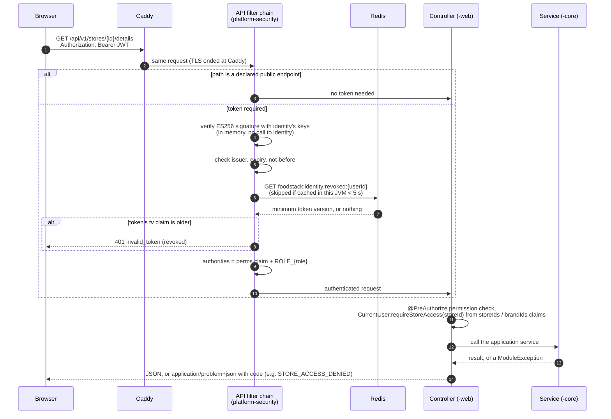
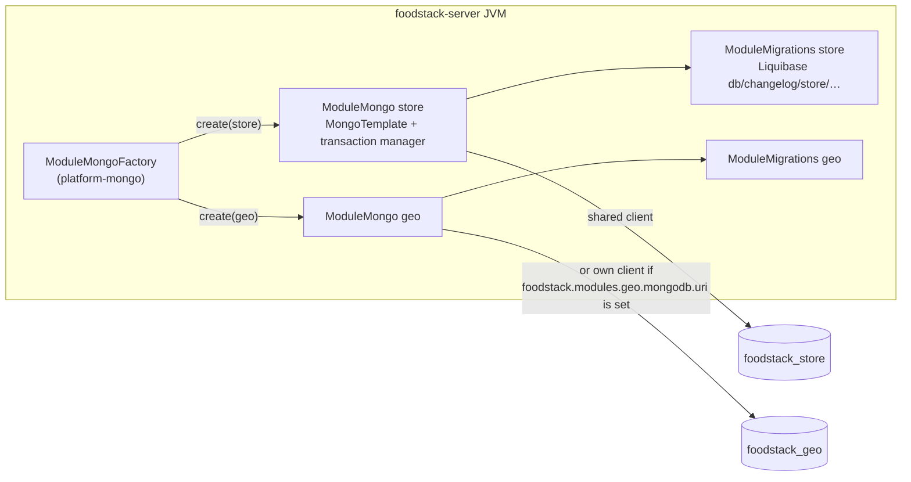
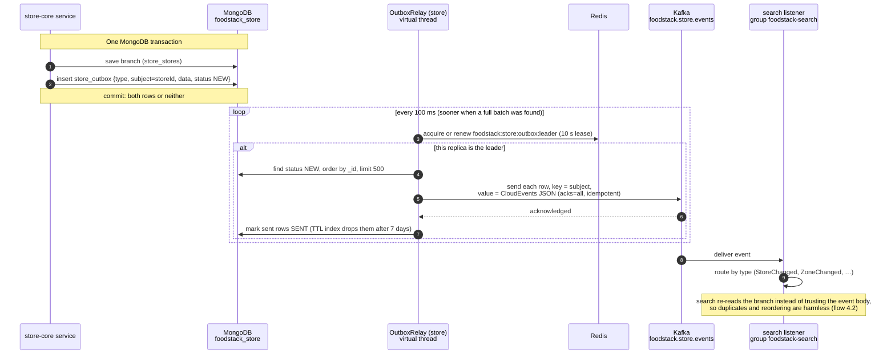
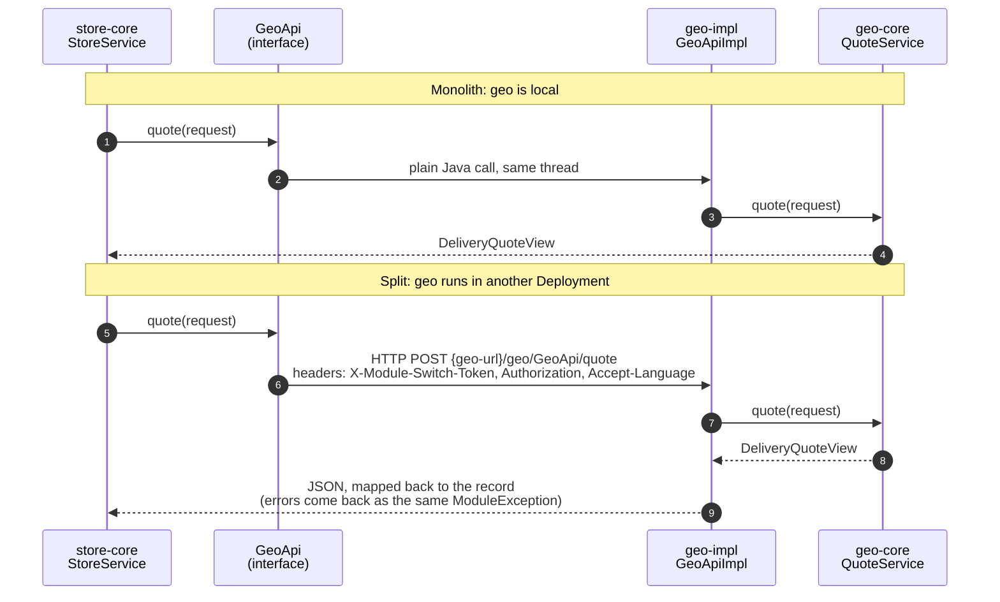

# 2. Platform mechanics

[Back to index](README.md)

The machinery every module shares. Code lives in `platform/` (`platform-security`, `platform-mongo`, `platform-kafka`, `platform-web`).

## 2.1 What happens to every request

Spring Security picks the first filter chain whose path matches. The chains, in order:

| Order | Chain | Paths | Rule |
|---|---|---|---|
| 1 | Authorization server (`identity-web`) | `/oauth2/**`, `/.well-known/**`, `/userinfo`, `/connect/logout` | Spring Authorization Server endpoints; a browser without a login session is sent to `/login` |
| 2 | Login (`identity-web`) | `/login`, `/login/**`, `/logout` | Form login page, open to all; keeps a server-side session |
| 10 | API (`platform-security`) | `/api/**` | Stateless JWT resource server. Endpoints a module declares as `PublicEndpoints` are open; everything else needs a valid token |
| last | Default | everything else | Only `/actuator/health/**`, `/actuator/info` and `/error` are open; the rest is denied |

- **Where the signing keys come from.** In the JVM that runs `identity`, the decoder reads the keys straight from `identity`'s `JWKSource` bean. In any other JVM (split topology) it downloads them once from `/oauth2/jwks` and caches them.
- **Revocation.** `identity` raises the user's `tokenVersion` (for example on "sign out everywhere"), writes the new minimum to Redis and also publishes `UserTokensRevoked`. Other modules read Redis, not the event. Each JVM caches the value for 5 seconds (`foodstack.security.revocation-cache-ttl`), so a revoked token can still pass for up to 5 seconds on a JVM that just checked it.
- **Public API endpoints today** (each declared by its module's `-web` configuration): `GET /api/v1/search/stores`; `GET /api/v1/stores/{key}`, `/{key}/menu`, `/{key}/delivery-quote`; `GET /api/v1/settings/branding`, `/locale`; `GET /api/v1/geo/addresses`, `/addresses/reverse`, `/addresses/availability`; `POST /api/v1/auth/register`. Everything else under `/api/**` needs a token.

## 2.2 Each module gets its own database

- One MongoDB cluster, one database per module (`foodstack_<module>`), every collection prefixed with the module name.
- A module's Liquibase changelog runs at start-up, before the app takes traffic, only in the JVM where that module is `local`. Tracking collections are `<module>_databasechangelog` and `<module>_databasechangeloglock`.
- With `foodstack.mongodb.sharding.enabled=true`, the declared shard keys are applied after migration (CI runs this against a two-shard cluster).
- `--foodstack.migrate-only=true` runs every module's migrations and exits (used before an upgrade).

## 2.3 Events: outbox, relay, Kafka, consumer

- **Topics:** one per publishing module, `foodstack.<module>.events`, 24 partitions, 7-day retention, plus `.dlt` (30 days). They are created at start-up by each module's `KafkaAdmin.NewTopics` bean.
- **Ordering:** the key is the aggregate id, so events of one branch stay in order. If a send fails, only rows before the failure are marked sent; the failed row and the ones after it go again on the next poll.
- **Delivery guarantee:** at least once. The only consumer today (search) is idempotent by design, so it does not use the inbox collection.
- **Leader lock:** one relay per module across all replicas. A Lua script takes the lock if free or renews it if this replica already holds it.
- **When a consumer fails:** no error handler is configured, so Spring Kafka's default applies: 10 attempts with no pause, then the record is logged and skipped. Nothing is written to the `.dlt` topic yet; see [Code vs design](05-code-vs-design.md).

## 2.4 What is in Redis

Every key starts with the namespace `foodstack`. Redis holds caches and coordination only; losing it loses no business data.

| Key | Written by | Value | Lifetime | Evicted when |
|---|---|---|---|---|
| `foodstack:settings:cache:branding`, `…:locale` | `settings` | Branding or locale JSON | 10 min (`foodstack.settings.cache-ttl`) | `settings` saves a change |
| `foodstack:store:menu:{storeId}` | `store` | The branch's effective menu (brand menu filtered by branch, with sold-out marks) | 10 min (`foodstack.store.menu-cache-ttl`) | A menu edit (all branches of the brand) or a sold-out change (that branch), right after the transaction commits |
| `foodstack:geo:cache:geocode:q:{lang}:{text}` and `…:r:{lang}:{lat}:{lng}` | `geo` | Address search or reverse geocode results (point rounded to about 11 m) | 7 days (`foodstack.geo.geocoding.cache-ttl`) | Never; expires |
| `foodstack:identity:revoked:{userId}` | `identity` | Lowest token version still valid | No expiry | Overwritten on the next revocation |
| `foodstack:{module}:outbox:leader` | each publishing module | Id of the replica that relays the outbox | 10 s, renewed every poll | Released on shutdown |

Not in Redis yet (designed in TDD 10, not built): idempotency keys, rate limits, login codes, rider locations, dispatch locks, SSE fan-out.

## 2.5 Module to module: monolith vs split

The same code runs in both shapes; only configuration (`module-switch.modules.<m>.mode`) changes.

- `Authorization` and `Accept-Language` are forwarded (`module-switch.propagate-headers`).
- The integration tests run every journey twice: once as a monolith and once with one application context per module talking over HTTP (`integration-tests`, `Topology.MICROSERVICES`).
