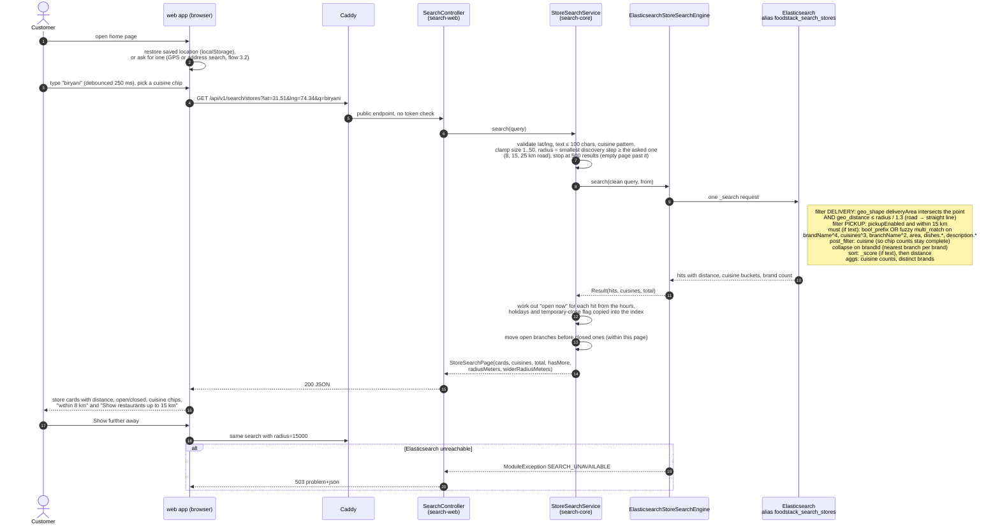
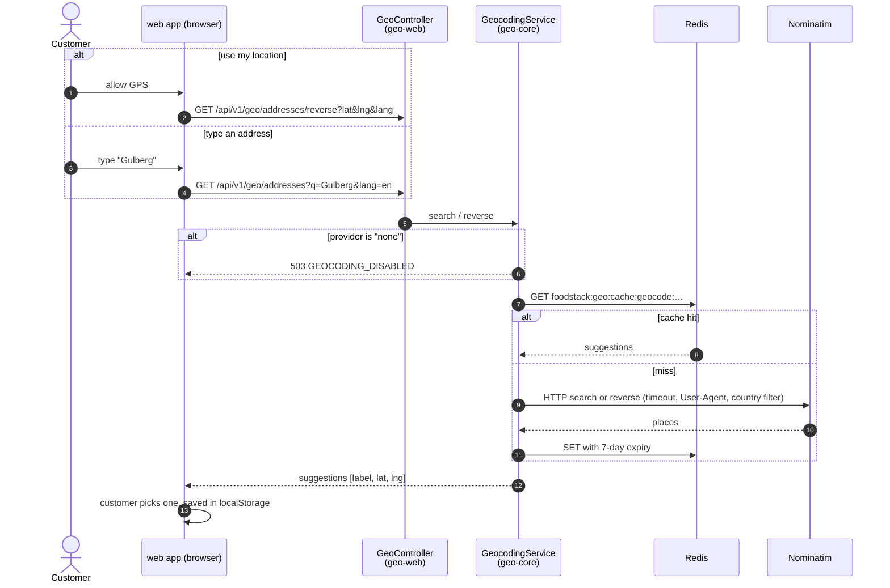
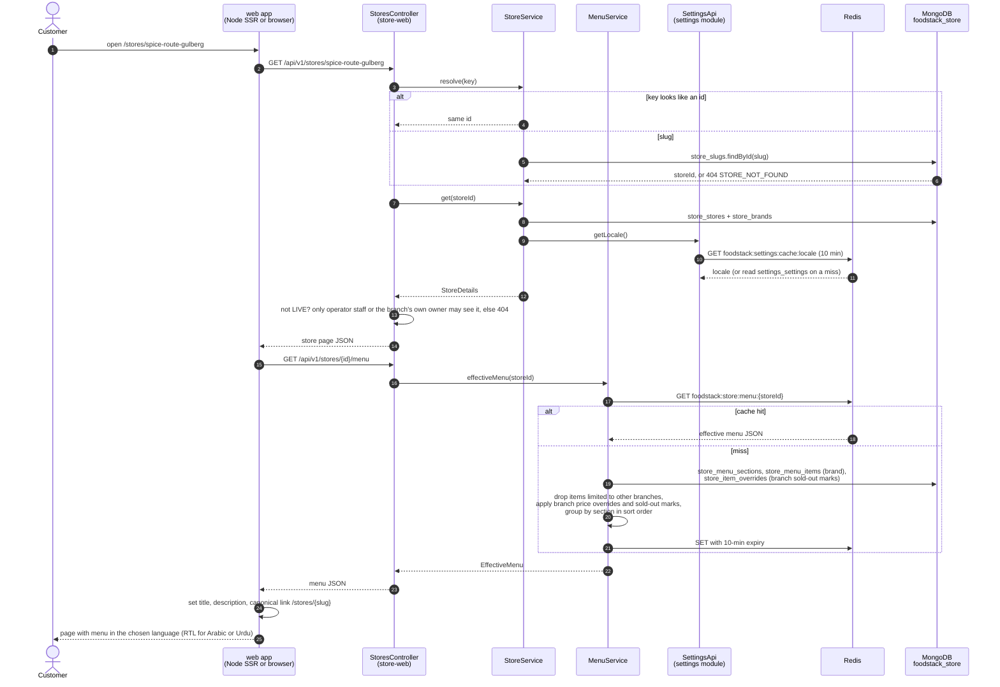
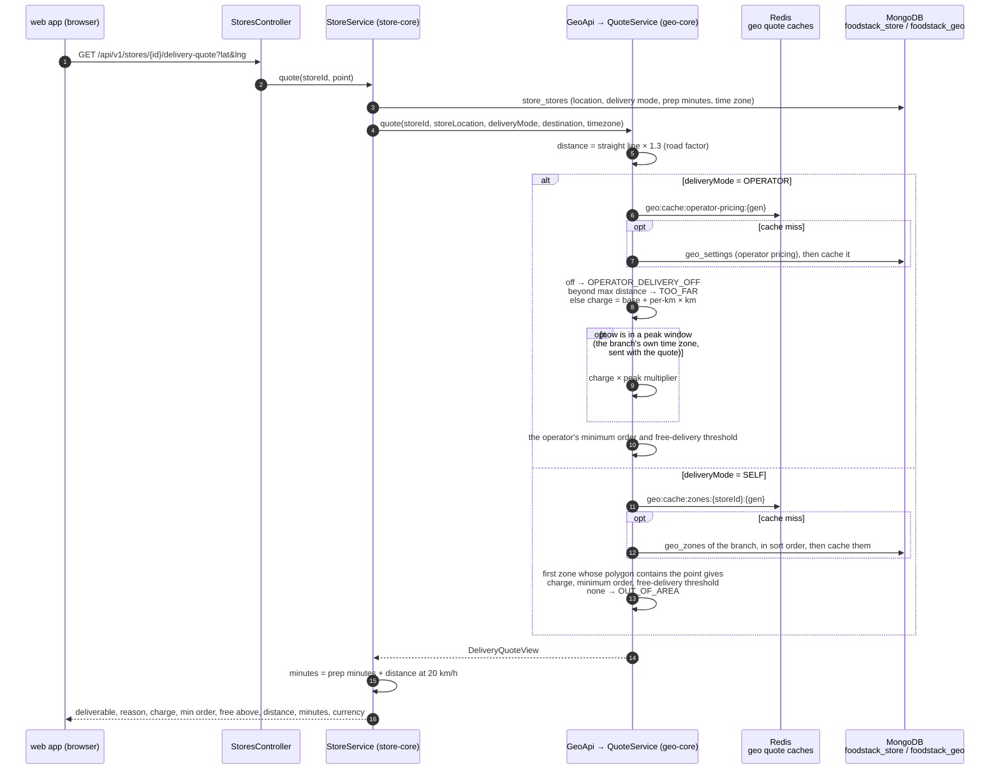

# 3. Customer flows

[Back to index](README.md)

The customer app is `frontend/projects/web` (Angular, server-side rendered on Node). Every page is rendered on the server per request; code that needs the browser (saved location, map, delivery quote) runs only after the page reaches the browser (`afterNextRender`).

## 3.1 Nearby store search

`GET /api/v1/search/stores?lat=&lng=&q=&cuisine=&fulfilment=DELIVERY|PICKUP&radius=&page=&size=` (public, no token).

**What is used:** Elasticsearch only. No MongoDB, no Redis, no Kafka on this path.

**Where the "delivers to me" answer comes from.** Each indexed branch carries a `deliveryArea` shape. For a self-delivery branch it is the union of the zone polygons the owner drew. For an operator-delivery branch it is a 48-point circle around the branch whose radius is the operator's maximum delivery distance divided by the road factor (1.3). The shape is computed by `geo` when the branch is indexed (flow 4.2), so the search request itself never calls `geo`.

**Discovery radius.** A self-delivery branch may draw zones as large as it likes, so the zone alone could fill a search with far-away branches. Search therefore also asks for the branch to be within the discovery radius of the customer (road distance, `foodstack.search.discovery-steps-km`, default 8, 15 and 25 km, divided by `road-factor` 1.3 for the straight-line filter). The page says which radius it used and the next step, and the customer widens it with one tap. Pickup uses its own 15 km radius. A direct branch link and checkout never apply the radius: only the zone decides whether a branch delivers.

**Scale settings.** Shards and replicas of the index come from `foodstack.search.shards` and `auto-expand-replicas` (default `0-1`, `0-all` on a large cluster); a branch's document is written with its version as an external version, so a late, older re-read is refused; brand lookups page through a point in time.

**Languages.** Dish names and descriptions are stored per language (`dishes.en`, `dishes.ar`, …) with one analyzer that lower-cases, folds accents and normalises Arabic and Persian script, so "برياني" and "biryani" each match their own language's text.

**How fresh the index is.** A change in the back office reaches search after: commit, then the outbox relay's next poll (up to 100 ms), then Kafka delivery, then the re-read and index write, then Elasticsearch's refresh (about 1 s). In practice a second or two.

## 3.2 Address lookup (location picker)

`GET /api/v1/geo/addresses?q=&lang=` and `GET /api/v1/geo/addresses/reverse?lat=&lng=&lang=` (public).

## 3.3 Store page and menu

`GET /api/v1/stores/{slug-or-id}` and `GET /api/v1/stores/{id}/menu` (public). The page is rendered on the Node server for the first load (so search engines and link previews see the menu) and in the browser on later navigation.

## 3.4 Delivery quote on the store page

`GET /api/v1/stores/{id}/delivery-quote?lat=&lng=` (public). Runs only in the browser, once a saved location exists.

The point-in-polygon test runs in Java (`GeoMath.contains`), not in MongoDB. A branch's zones and the operator pricing are cached in Redis for 10 minutes (`GeoCache`, generation keys raised after each change and again by `geo`'s event listener on every replica), so a quote normally reads no MongoDB in `geo`. Peak windows are days and times in the branch's local time zone (each branch has its own, found from its location); a window whose end is before its start runs past midnight. Checkout enforces the quote's minimum order and free-delivery threshold for both delivery modes.
