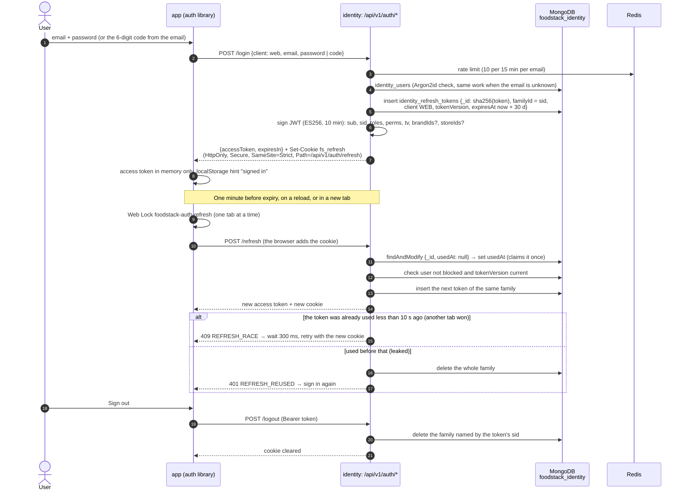
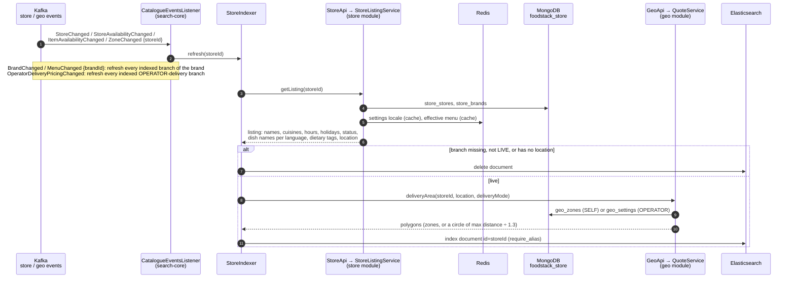
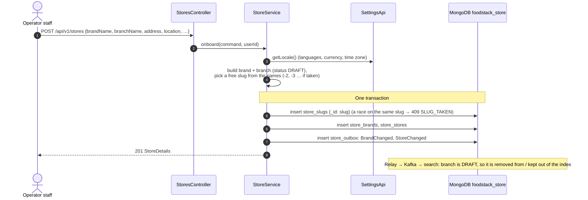
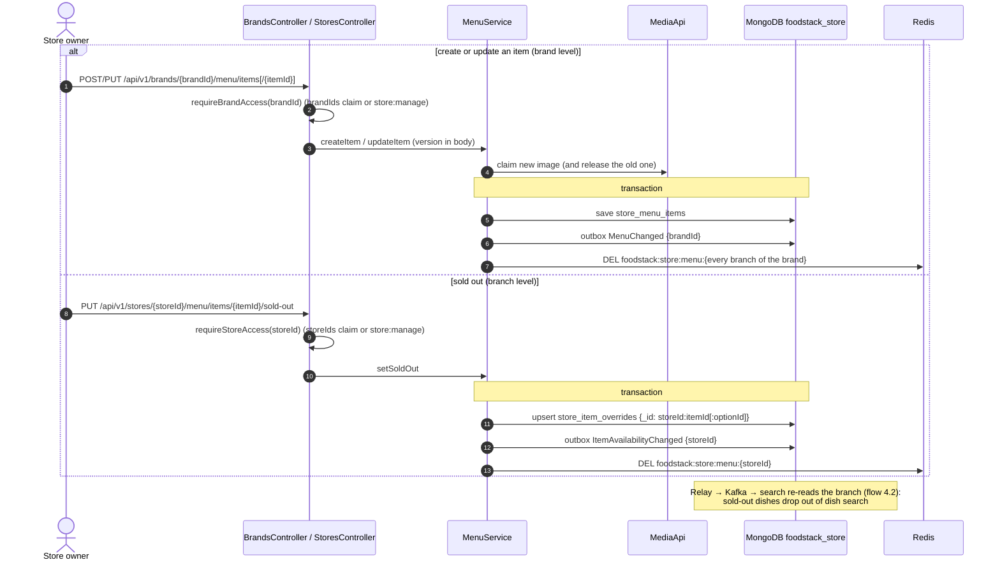
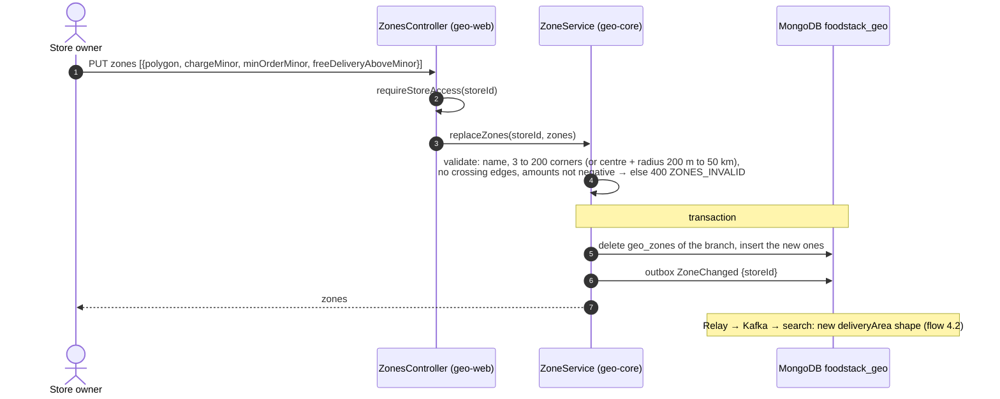
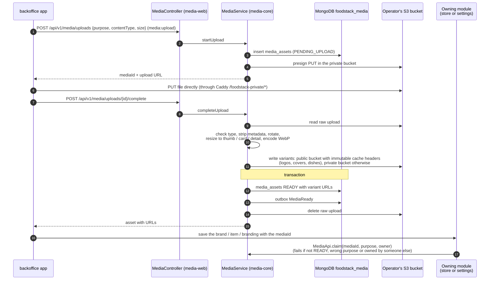

# 4. Back-office flows

[Back to index](README.md)

The back office is `frontend/projects/backoffice` (Angular, served by nginx under `/admin`). Operator staff and store owners use the same app; what they see depends on the permissions in their token.

## 4.1 Sign-in and silent token renewal

The stateless auth API of `identity` (TDD 9.1). Both apps show their own sign-in screen (`fs-sign-in` in the `auth` library, at `/admin/sign-in` and `/sign-in`): password, emailed code, password reset and, in the customer app, sign-up. There is no redirect and no server session, so any replica answers any call.

- **Mobile apps** log in with `client: mobile`: the refresh token comes in the body, is kept in the Keychain or Keystore and sent back in the body. A token is accepted only on its own channel (`REFRESH_WRONG_CHANNEL`), and a call with both a cookie and a body token is refused (`REFRESH_TWO_CHANNELS`).
- **Sign-out everywhere, block or password reset** raise the user's `tokenVersion` (flow 4.9): access tokens stop at once (flow 2.1) and each sign-in ends at its next refresh.
- **Keys:** the signing keys come from `FOODSTACK_SIGNING_KEYS`. Without them (development only) a temporary key is generated, and every token stops working on restart. Spring Authorization Server remains only for `/oauth2/jwks`, its metadata and the service token of split deployments.
- **Cookie on plain HTTP:** a local trial without TLS sets `foodstack.identity.refresh-cookie-secure: false` (the Docker Compose trial's `application-local.yml` does it), or the browser would drop the cookie.

## 4.2 Store change → search index (the read model)

Every back-office write in `store` or `geo` ends with an event, and search rebuilds that branch's document from the source modules. This is the path that keeps [flow 3.1](03-customer-flows.md#31-nearby-store-search) correct.

- The listener reads only the id from the event. A duplicate or late event just rewrites the current state, so no inbox is needed.
- In the split topology, `getListing` and `deliveryArea` are HTTP calls from the search Deployment to the store and geo Deployments. The Kafka listener has no user, so no `Authorization` header is sent; it works because `-impl` classes do no permission checks (see [Code vs design](05-code-vs-design.md)).
- On start-up, if the index did not exist, it is created and filled in the background (`SearchIndexBootstrap`). `POST /api/v1/search/reindex` (`search:manage`) re-reads every branch on demand.

## 4.3 Onboard a store (operator)

`POST /api/v1/stores` (`store:manage`).

Adding an owner (`POST /api/v1/stores/{id}/owners`) calls `IdentityApi.grantStoreAccess`, which creates or updates the user with role `STORE_OWNER` and the brand and branch ids, so they appear in the user's next token. Removing an owner calls `revokeStoreAccess`, which also raises the user's token version so the old token stops working at once.

## 4.4 Edit the menu, mark sold out

## 4.5 Draw delivery zones

`PUT /api/v1/zones/stores/{storeId}` (store owner of that branch, or `store:manage`). The back office draws polygons on a MapLibre map; the API also accepts a centre and radius, turned into a 16-corner polygon.

`geo` does not check that the store exists; it trusts the `storeIds` claim or the operator permission.

## 4.6 Go live

`PUT /api/v1/stores/{id}/status {LIVE}` (`store:manage`). `StoreService.setStatus` first runs the readiness check: the branch needs a location, at least one menu item on its brand, and, unless pickup is on, a delivery area (asked from `GeoApi.deliveryArea`). If something is missing the answer is 409 `STORE_NOT_READY` with the list. Otherwise the branch is saved with a `StoreChanged` event, and search indexes it (flow 4.2), after which it appears in [flow 3.1](03-customer-flows.md#31-nearby-store-search).

## 4.7 Upload an image (logo, cover, dish photo)

## 4.8 Change branding or locale

`PUT /api/v1/settings/branding` or `/locale` (`settings:manage`, `If-Match` required). `SettingsService` claims a new logo through `MediaApi`, saves `settings_settings` with an outbox `SettingsChanged` in one transaction, releases the old logo, and deletes the Redis key `foodstack:settings:cache:branding` (or `:locale`). The next read in any module reloads it. Nothing consumes `SettingsChanged` yet; the customer app reads branding on each server render.

## 4.9 Sign out everywhere

`POST /api/v1/me/revoke-tokens`. `UserService.revokeTokens` raises the user's `tokenVersion`, saves it with an outbox `UserTokensRevoked`, then writes the new minimum to Redis (`foodstack:identity:revoked:{userId}`). From then on every module rejects older tokens (flow 2.1), within the 5-second local cache.
