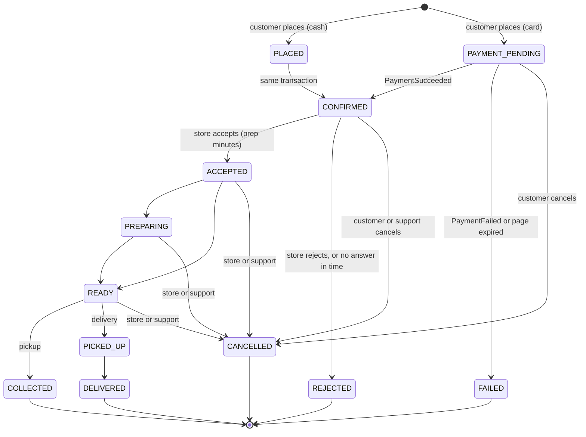
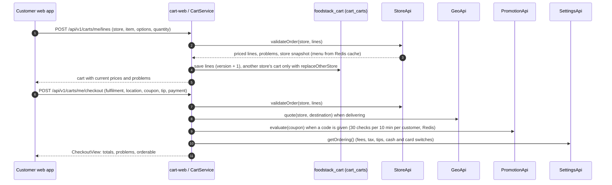
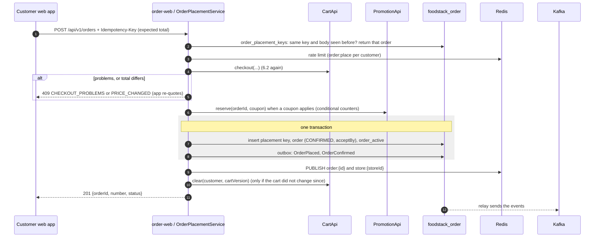
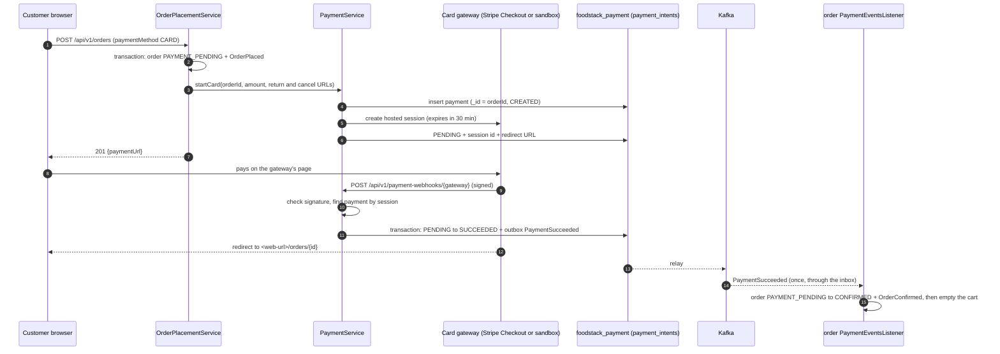
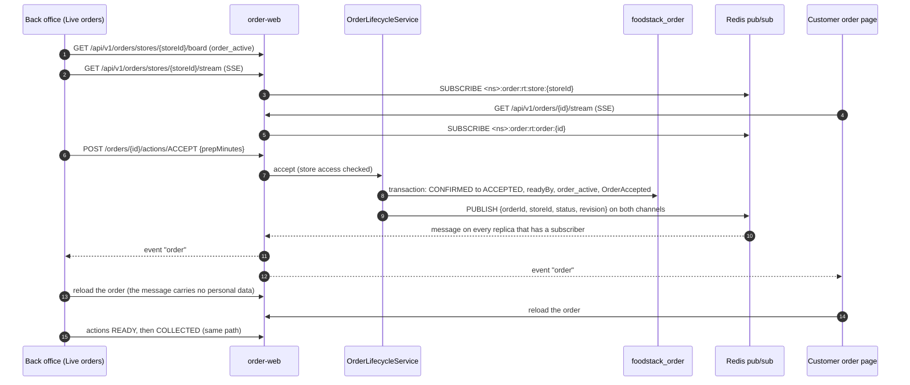
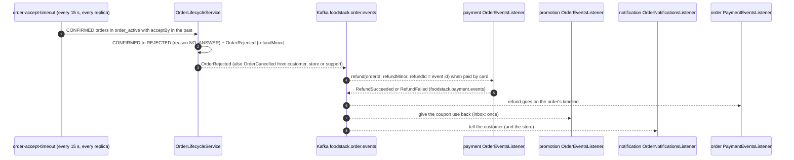
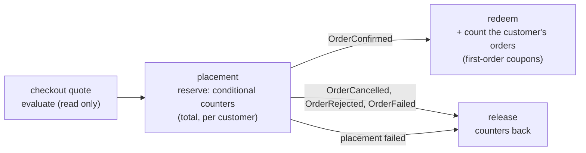
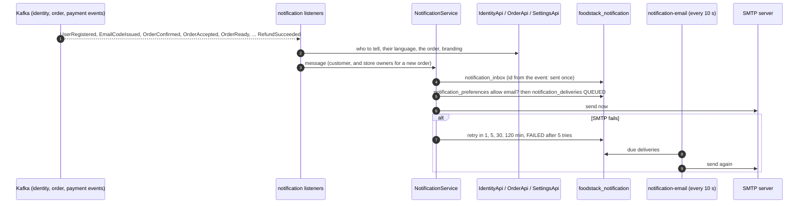
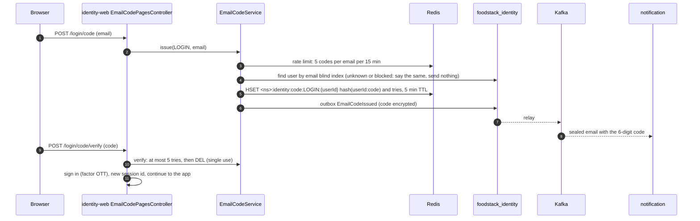

# 6. Ordering flows

[Back to index](README.md)

How an order moves through `cart`, `order`, `payment`, `promotion` and `notification` after M2, traced from the code. Solid arrows are synchronous calls (through a module's `-api` interface, or HTTP from a browser); dashed arrows are Kafka events or Redis messages.

## 6.1 The order's life

Every step is one conditional update of the order's `status` and `revision`, plus the matching `order_active` change and the step's event, in one MongoDB transaction (`OrderLifecycleService.step`). A step that lost a race is tried again on the fresh order or refused with `ORDER_STATUS_CHANGED`.

Each step publishes its own event on `foodstack.order.events`: `OrderPlaced`, `OrderConfirmed`, `OrderAccepted`, `OrderPreparing`, `OrderReady`, `OrderPickedUp`, `OrderDelivered`, `OrderCollected`, `OrderRejected`, `OrderCancelled`, `OrderFailed`, and `OrderRefunded` for a refund by support. Every event carries the same order summary (ids, number, status, money, store, customer), so a consumer never has to call back.

## 6.2 Cart and checkout quote

The cart keeps only what the customer picked (item, options, quantity, note). Prices are never stored: every read asks the store module for the current menu, so a price change or a sold-out dish shows at once.

Total = subtotal − food discount + delivery − delivery discount + service fee + tax + tip (`CheckoutMath`). The same `CheckoutService` runs again when the order is placed, so the customer pays exactly what they saw.

## 6.3 Place an order (cash)

If the transaction fails, the held coupon use is released. A second request with the same key and body returns the first order; the same key with a different body is refused.

## 6.4 Pay by card (hosted page)

The card number never reaches FoodStack: the customer pays on the gateway's page (Stripe Checkout, or the built-in sandbox page for tests), and the result comes back by webhook.

- A webhook delivered twice, or racing the expiry sweep, changes the payment once (conditional update on the status).
- `payment-expiry` runs every minute on every replica and expires pages past their time: `PaymentFailed` (reason `EXPIRED`) fails the order and gives the coupon back.
- A payment that succeeds after its page expired still counts: the order is already failed, so it is refunded at once.
- If the gateway does not answer when the page is opened, the order fails at once and the customer is told to try again or pay cash.

## 6.5 The store's live board: accept, ready, collected

The board beeps every 4 seconds while an order waits (when sound is on), counts down to the accept deadline and prints a kitchen ticket on accept. Both streams reconnect with a growing pause and reload once on reconnect, so a missed message is never a stale screen.

## 6.6 No answer, cancel, reject, refund

- Customers can cancel only before the store accepts. Stores can cancel after accepting; support can cancel at any step before the end and can refund part or all of a paid order (`POST /orders/{id}/refund`, `OrderRefunded`).
- The refund id is the event id, so a redelivered event never refunds twice. If the gateway says "maybe later", the handler throws and the event is retried, then dead-lettered.

## 6.7 Coupons: hold, redeem, give back

Counters live in `promotion_codes` (uses in total), `promotion_customer_usage` (`<promotionId>:<customerId>`) and `promotion_customers` (confirmed orders per customer). The reservation is a `promotion_redemptions` document keyed by the order id, so a hold, redeem or release happens once per order. Event handlers go through the inbox because counters are not idempotent.

## 6.8 Notifications: in-app and email

- The bell in the customer app reads `GET /api/v1/notifications` and the unread count; operators see the email log at `GET /api/v1/notifications/deliveries` and can send one again.
- Sign-in and reset codes are "sealed": the email body is stored encrypted and wiped once sent or failed, and the log shows only the subject.
- Order and account emails respect `notification_preferences` (order emails on by default, offers off); sign-in codes are always sent.

## 6.9 Sign in with an email code, reset a password

Password reset is the same with purpose `PASSWORD_RESET`: the new password is checked before the code is used up, then the password is changed and every token of the user is revoked (`PASSWORD_RESET`). A signed-in user changes their password with `PUT /api/v1/me/password` (current password required).
