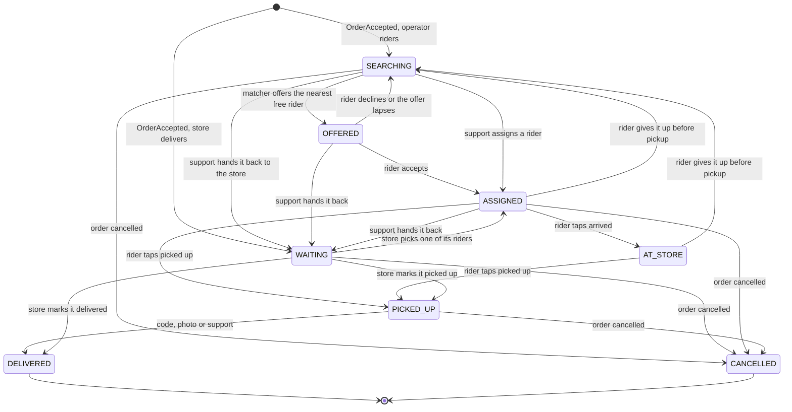
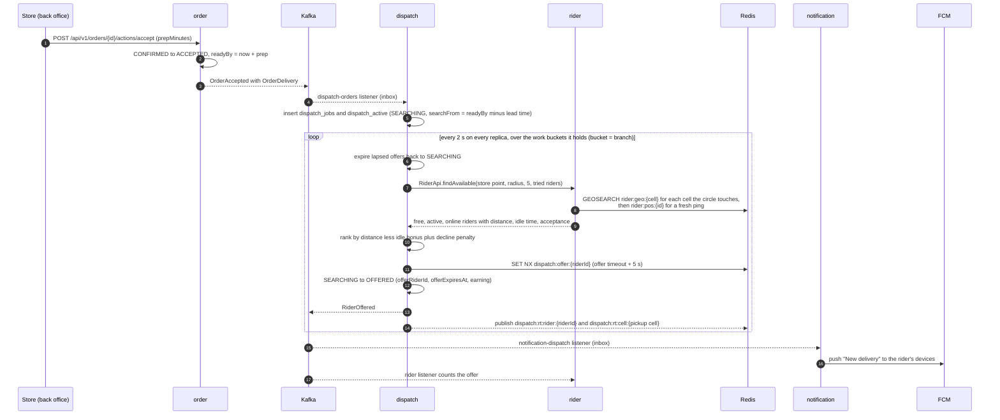
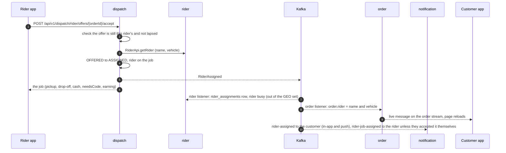
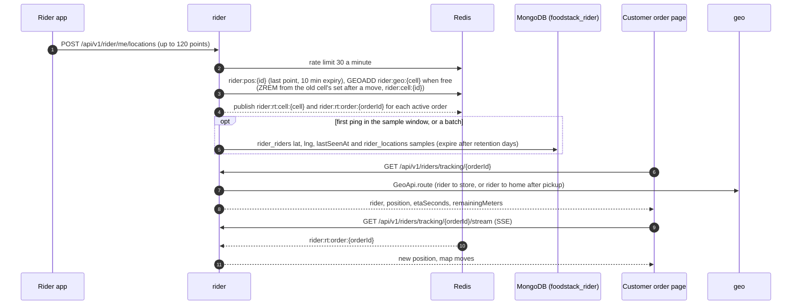
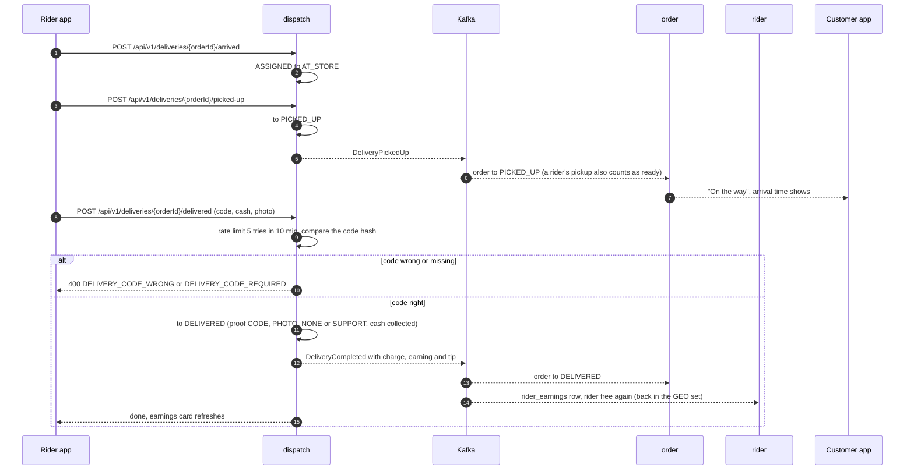
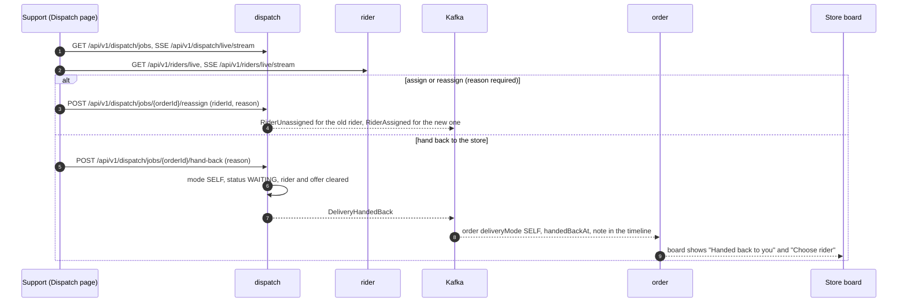
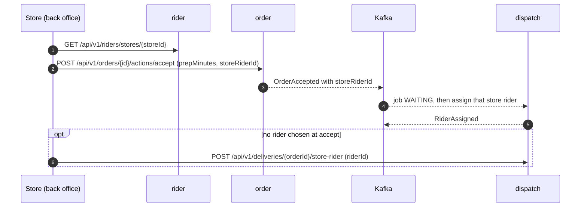
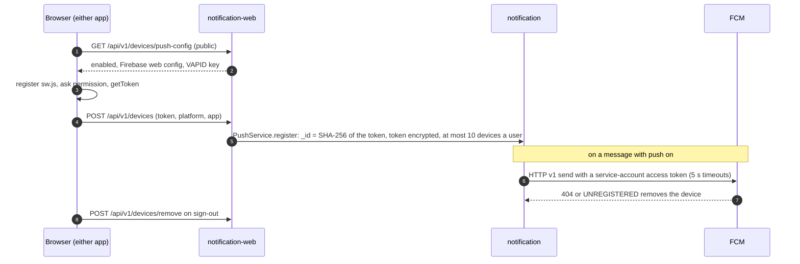
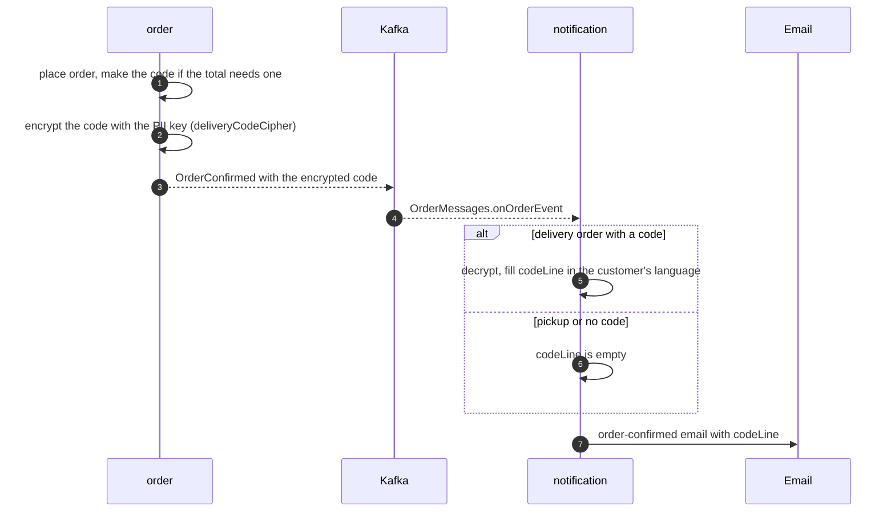
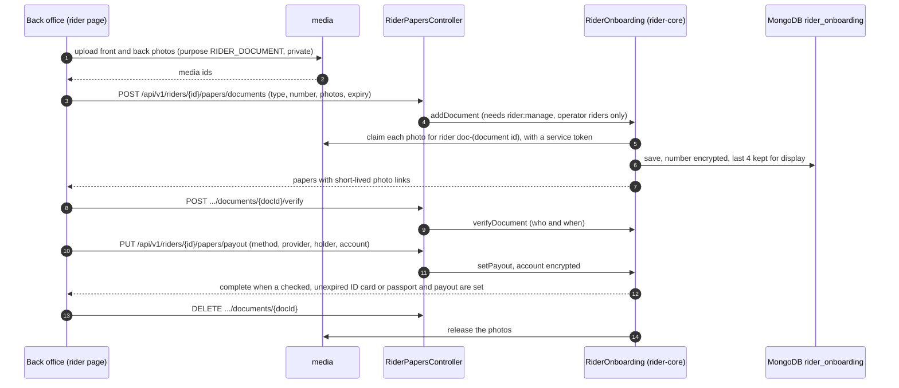

# 7. Delivery flows

[Back to index](README.md)

How a delivery order moves through `order`, `dispatch`, `rider`, `geo` and `notification` after M3, traced from the code. Solid arrows are synchronous calls (through a module's `-api` interface, or HTTP from a browser); dashed arrows are Kafka events or Redis messages. Who delivers is a store setting: `OPERATOR` (the operator's riders, found by dispatch) or `SELF` (the store's own riders, or the store with nobody chosen).

## 7.1 The delivery job's life

`dispatch` keeps one job per delivery order (`dispatch_jobs`, `_id` = order id) and a small copy of every unfinished job (`dispatch_active`) for the matcher and the dispatch board. Every change is one conditional update of the job's `status` and `revision` plus its event, in one MongoDB transaction (`DispatchService.change`).

`HANDED_BACK` is not a status of its own: a handed-back job becomes a `WAITING` self-delivery job and keeps the reason in `closeReason`. A store rider's job given up before pickup goes back to `WAITING`, not `SEARCHING`. A cancelled order closes the job from any open status (`OFFERED` and `AT_STORE` too; the diagram shows a few). Support's reassign first takes the job off the old rider (`RiderUnassigned`), then assigns from `SEARCHING` or `WAITING`.

Events on `foodstack.dispatch.events`: `RiderOffered`, `RiderAssigned`, `RiderUnassigned`, `DeliveryPickedUp`, `DeliveryCompleted`, `DeliveryCancelled`, `DeliveryHandedBack` and `DispatchAlert`. Each carries the same delivery summary (order id and number, store, mode, rider), so a reader never calls back.

## 7.2 Store accepts, dispatch finds a rider

The delivery code is made when the order is placed (4 digits, only when the total is at least the operator's **Ask for the code above** amount). The order keeps the code encrypted with the PII key (`deliveryCodeCipher`). `OrderAccepted` carries what dispatch needs (`OrderDelivery`: pickup, drop-off, customer, cash to collect, the encrypted code); dispatch decrypts it once and keeps only a hash. See 7.10 for the code in the confirmation email.

When nobody free is in range, the job stays `SEARCHING`: after each 45-second round with no rider the radius grows by half (at most twice), riders who declined may be tried again after 3 minutes, and once the job has searched for **Alert support after**, one `DispatchAlert` goes out and `notification` tells admin and support users (in-app and push, link `/dispatch`).

## 7.3 The rider accepts

An operator rider holds one job at a time, so a busy rider is removed from the GEO set of their cell until the job ends.

## 7.4 Live position and tracking

The rider app sends its position every 10 seconds while online (and a queued batch after being offline). The customer and the store follow one delivery; the operator's dispatch map follows the riders and jobs in the area it shows.

**The operator's live map at country scale.** The map sends its view (south, west, north, east) and subscribes to the live channels of the 0.25° cells it shows, at most 64 (an area of about 220 × 220 km at most); a wider view gets the board without live dots and the hint "Zoom in to follow riders live". Moving the map re-subscribes after 600 ms. On Redis Cluster the channels use sharded pub/sub, so each message reaches only the node that owns its channel.

`geo` answers routes with OSRM when `ROUTING_PROVIDER=osrm`, otherwise with the straight-line distance times a road factor at an urban average speed. The customer sees the arrival time only after pickup; before that the card says the rider is heading to the restaurant. Riders that stop pinging for 5 minutes are set offline by `rider-stale-sweep` (every minute).

## 7.5 Pickup and handover

The photo is uploaded first through `media` (purpose `RIDER_DOCUMENT`) and sent as `media:<id>`. Support may finish a job without the code (proof `SUPPORT`). The rider's earning is a share of the normal delivery charge (`riderPayBasisMinor`, before a free-delivery threshold or delivery coupon), with the minimum pay as a floor, so free deliveries pay the rider the same.

## 7.6 Support: reassign and hand back

## 7.7 A store that delivers itself

Store riders belong to one branch (`rider_riders.kind = STORE`, `storeId`). They never get offers; the store chooses.

Without any rider the store marks the order picked up and delivered on its board as before (M2), and `dispatch` closes the job from `OrderPickedUp` and `OrderDelivered`.

## 7.8 Push devices

Push is on only when `FCM_SERVICE_ACCOUNT` is set; the apps hide the "Turn on notifications" banner otherwise. In-app messages are always kept, so nothing depends on push arriving.

## 7.9 Saved addresses

Customers keep up to 20 addresses (`identity_addresses`, one `HOME`, one `WORK`, any number of named `OTHER`), each with a map pin and notes for the rider, through `GET`, `POST`, `PUT` and `DELETE` on `/api/v1/me/addresses`. The web app starts with the preferred one, checkout picks one, and a typed address is saved after the first order. The address on an order is a copy, so editing or deleting a saved address never changes past orders.

## 7.10 The delivery code in the confirmation email

The code is in clear only in memory while the email is written; the email itself is the customer's copy (PRD DR-6).

## 7.11 Rider papers

The riders list asks `GET /api/v1/riders/papers/complete` and marks other operator riders **Papers missing**. A save that raced another edit answers 409 `RIDER_PAPERS_CHANGED`.

