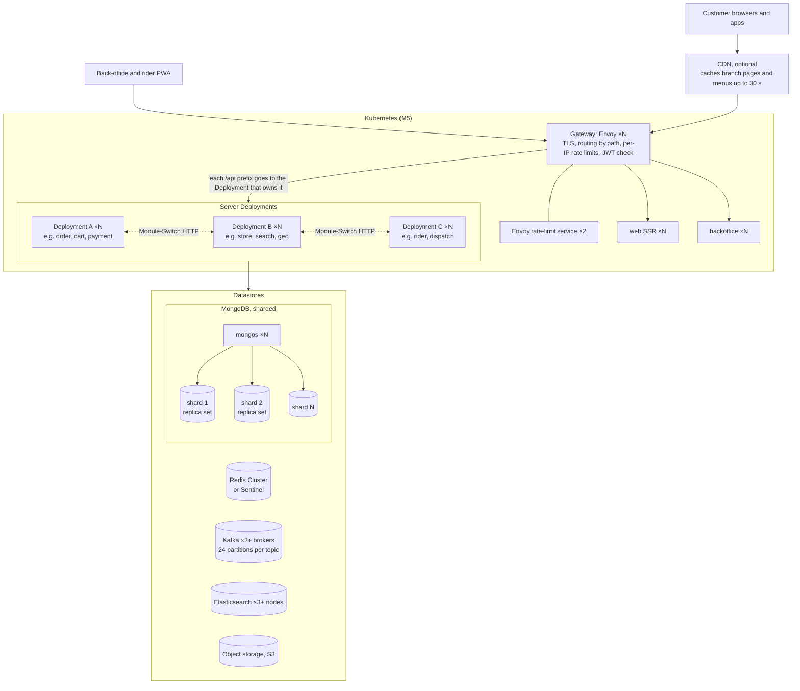
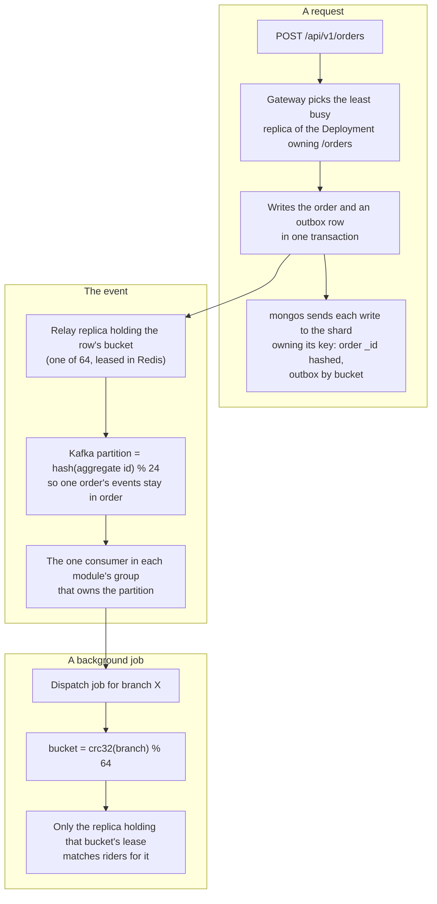
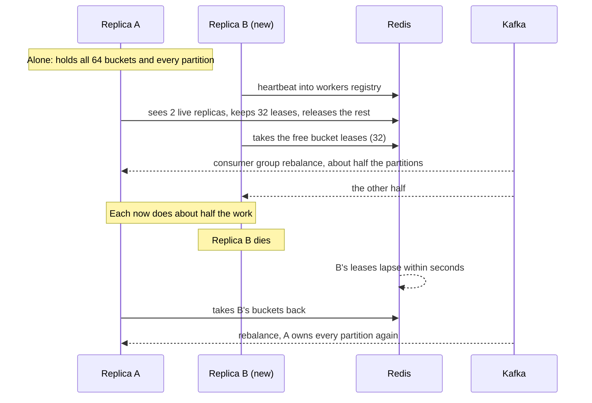
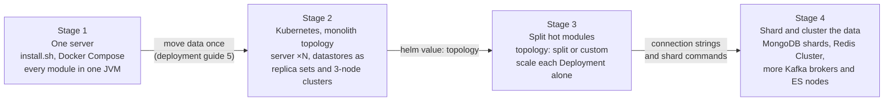

# 8. How FoodStack scales out

[Back to index](README.md)

FoodStack grows by adding machines and changing configuration, never by changing code. One server runs exactly the same code as a national deployment. This page shows how each kind of load is split between machines, what you change at each stage, and the few things that do not grow with more machines.

Where a step needs the Kubernetes chart, it is marked **(M5)**: the chart is planned and not built yet ([Code vs design 5.3](05-code-vs-design.md#53-designed-but-not-built-yet-by-plan)). Everything else is built (PR #7) and tested: CI runs every repository test against a two-shard MongoDB, and every integration journey twice, as a monolith and as microservices.

## 8.1 The scaled-out picture

What a large deployment looks like. Every box with "×N" is added by raising a number; nothing in the code knows how many there are.

- How many server Deployments there are, and which modules each runs, is one Helm value (`topology`). Datastores can be managed services or run by an operator.
- Any replica can answer any request: there is no server session. Access tokens are checked locally against the published keys, refresh tokens live in MongoDB, and revocations in Redis (TDD 9.1).
- A topology change only moves modules between Deployments. **No data moves** when you change topology.
- Each module can also get its own MongoDB cluster by setting its connection string ([deployment guide 4.7](../deployment-guide.md#47-moving-one-modules-data-to-its-own-mongodb-cluster)).

## 8.2 How each kind of load is split

| Load | Split by | What spreads it | Add capacity by |
|---|---|---|---|
| API requests | Any replica | Stateless servers behind the gateway's load balancer | More replicas (HPA) |
| Live updates (SSE) | The replica holding the connection | Redis pub/sub per order, per rider and per 0.25° map cell (sharded pub/sub on a cluster) | More replicas; Redis Cluster nodes |
| Events | Kafka partition (key: aggregate id) | 24 partitions per topic, one consumer group per module | Replicas × listener threads, up to 24 per module |
| Background work (outbox relay, dispatch matcher, accept-timeout sweep) | Work bucket, `crc32(key) % 64` | Redis leases, rebalanced when a replica joins or dies | More replicas, up to 64 sharing each job |
| Data | MongoDB shard key per collection | `mongos` routes each hot query to one shard | More shards |
| Cache and coordination | Redis key slot | Every command uses one key, so Redis Cluster spreads them | More Redis Cluster nodes |
| Search | Elasticsearch shards and replicas | Replica count follows nodes (`auto_expand_replicas`) | More nodes; more primary shards on the next rebuild |
| Images | Object storage | Served straight from storage (or a CDN), never through Java | Storage scales by itself |
| Branch pages and menus | URL | `Cache-Control: public, s-maxage=30` and ETags | A CDN in front |

### How a request, an event and a background job find their machine

### What happens when a replica joins or dies

## 8.3 Growing step by step

Each stage keeps the code and the data. Only configuration and machines change.

| Stage | When | What you change | Guide |
|---|---|---|---|
| 1. One server | Launch, one city | Nothing: `install.sh` | [Deployment guide 3](../deployment-guide.md#3-single-server-unit-deployer) |
| 2. Kubernetes, monolith (M5) | The server's CPU stays busy at peak, or you need no downtime on upgrades | Move the data once, install the chart, raise `replicas` | [5](../deployment-guide.md#5-moving-from-a-single-server-to-kubernetes), [4.6](../deployment-guide.md#46-scaling-and-topologies) |
| 3. Split modules (M5) | One part (ordering at lunch, live maps) needs far more than the rest | `topology: split` or `custom` | [4.6](../deployment-guide.md#46-scaling-and-topologies), [TDD 18.2](../TDD.md#182-module-topology-one-setting-any-shape) |
| 4. Shards and clusters | MongoDB primary or Redis memory is the bottleneck, search is slow under load | Connection strings, `sh.shardCollection` with the keys in TDD 6.3, `auto_expand_replicas`, brokers | [4.6a](../deployment-guide.md#46a-growing-the-other-datastores), [4.8](../deployment-guide.md#48-growing-mongodb-replicas-and-shards) |

Step-by-step runbooks for each stage, written for people without an operations background, are planned as milestone **M6 Operator handbook** ([PRD 7](../PRD.md#7-release-plan)).

## 8.4 Limits that more machines do not lift

Choose these early, or know they exist.

| Limit | Why | What to do |
|---|---|---|
| At most 24 busy consumers per module per topic | A Kafka partition goes to one consumer in a group | Plenty for one country. Adding partitions later is possible but re-maps keys, so per-order ordering is not kept during the change: do it in a quiet hour |
| At most 64 replicas share each background job | 64 fixed work buckets | Far above need; the number is fixed so buckets never move between records |
| A very busy shard key | One branch or customer can only be on one shard for its hot rows | Keys were chosen and checked for skew (TDD 6.3); `order_by_store` is compound so a busy store's history still splits |
| Search full re-read | One job, run by one replica at a time | Runs daily and on demand; normal updates are per branch through Kafka |
| Order placement | A distributed transaction across shards | Accepted; it touches few documents |
| Admin "all orders" list | Reads every shard | Accepted: low traffic, staff only |
| Map views wider than 64 cells | Each map follows at most 64 cells | The map asks staff to zoom in |
