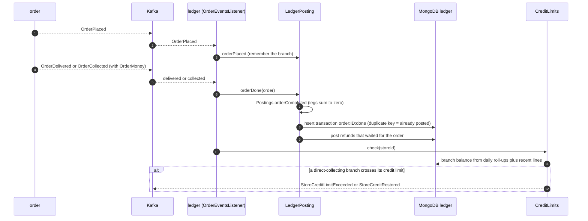
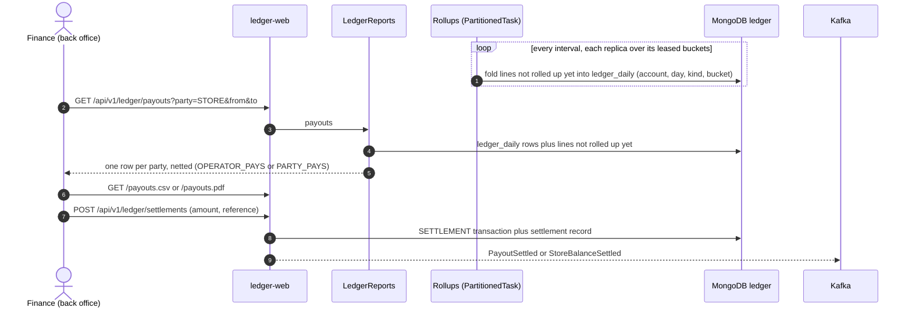
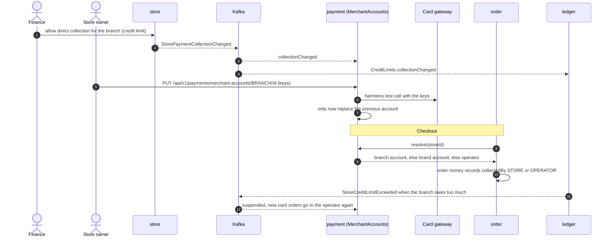
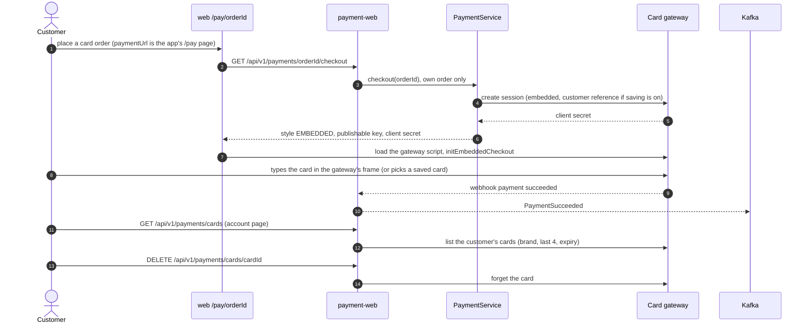
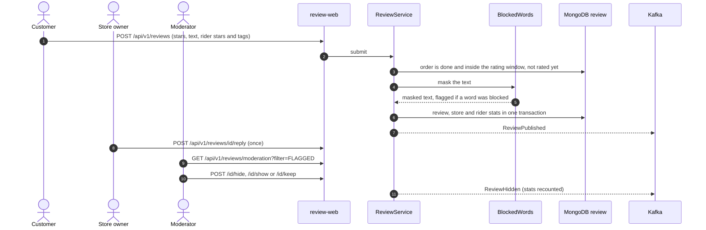
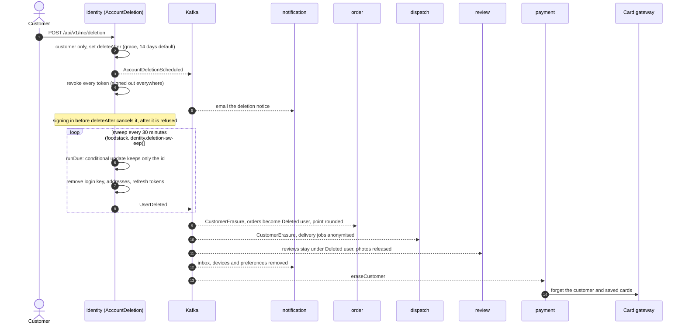
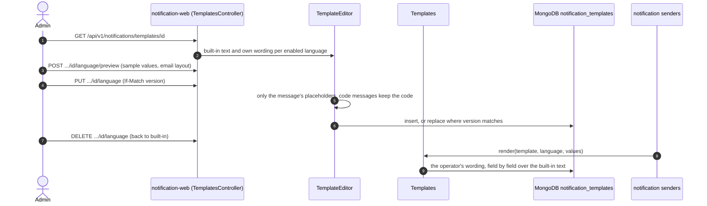

# 9. Money, reviews and privacy flows (M4)

[Back to index](README.md)

What M4 added, traced from the code: the `ledger` and `review` modules, stores that collect card payments themselves, card fields inside the app and saved cards, a customer's data export and account deletion, and the operator's message editor. Solid arrows are synchronous calls (HTTP from a browser, or a module's `-api` interface); dashed arrows are Kafka events.

## 9.1 Ledger: posting an order

`ledger` never asks other modules for anything. It listens to `order`, `payment`, `dispatch`, `store` and `settings` events and writes balanced double-entry transactions into `ledger_transactions` (append-only, sharded by `storeId`). Each transaction has a fixed id (`order:<id>:done`, the event id for refunds), so a redelivered event posts nothing new. The rules are pure functions in `Postings`, each tested on its own.

Where the customer's money comes from in `orderCompleted`:

| Order | Taken from |
|---|---|
| Card, operator's account | `prepaid` clearing account (filled by `PaymentSucceeded`) |
| Cash, operator rider | `cash` clearing account (the rider's cash, moved onto the rider by `DeliveryCompleted`) |
| Cash, store delivers or pickup | the branch account, line kind `CASH` (the branch holds it for the operator) |
| Card into the branch's own merchant account | the branch account, line kind `COLLECTED` |

It is then shared out: food, tax and the store's own delivery charge to the branch, less the discounts it funds and the commission. Commission (percent of food after store-funded discounts, plus a fixed amount), the operator's delivery charge and the service fee go to the operator, less the discounts it funds. Tips go to the branch, or to the rider pool for operator deliveries until `DeliveryCompleted` names the rider.

A refund on an order still in progress waits on the order's row (`pendingRefunds`) and is posted when the order is done, against whoever support chose (`fundedBy`, default store). If the order is cancelled instead, the waiting refund is dropped, because the customer simply gets the money back.

## 9.2 Ledger: roll-ups, payouts and settlement

A store owner calling the same endpoints sees only their own branches. Days are counted in the deployment's time zone (`settings` locale).

## 9.3 Stores that collect card payments themselves

A branch's account is used only while the deployment switch is on, finance allows the branch, and the ledger has not suspended it. If the gateway refuses the keys while taking a payment (`markFailed`), new orders go to the operator too. Webhooks for a store account arrive at `/api/v1/payment-webhooks/{gateway}/{scope}/{ownerId}`, checked with that account's secret.

## 9.4 Card fields inside the app and saved cards

Card numbers never reach FoodStack's servers or page code. The gateway's script draws its own fields inside its own frame (Stripe embedded Checkout); on the hosted style the customer leaves for the gateway's page. FoodStack keeps only the gateway's customer reference.

The operator picks the style (`cardStyle`: `HOSTED_PAGE` or `EMBEDDED`) and whether customers may save cards (`savedCardsEnabled`) on the back-office Ordering page. Both apply to the operator's account only; a branch's own account always uses the hosted page. The sandbox gateway imitates the embedded fields with a pretend form posting to `/api/v1/payments/sandbox/{orderId}/card`.

## 9.5 Reviews

`review` learns which orders can be rated, and by whose rider, from `order` and `dispatch` events (`FinishedOrdersListener` sets fields on `review_orders`, so arrival order does not matter).

The public store page shows the customer as first name and last initial. A second rating of the same order gets `409 REVIEW_ALREADY_RATED`.

## 9.6 Data export and account deletion

The export is composed by the customer's browser from each module's own endpoint, so no module reads another's data: `GET /api/v1/me/export` (identity), `/api/v1/orders/mine/export`, `/api/v1/reviews/mine/export` and `/api/v1/notifications/mine/export`.

Accounts with back-office roles get `409 ACCOUNT_HAS_STAFF_ROLES`: an admin closes them. Every consumer is safe to run again.

## 9.7 The operator's message editor

A language without built-in text uses the English wording, the operator's English wording included.
