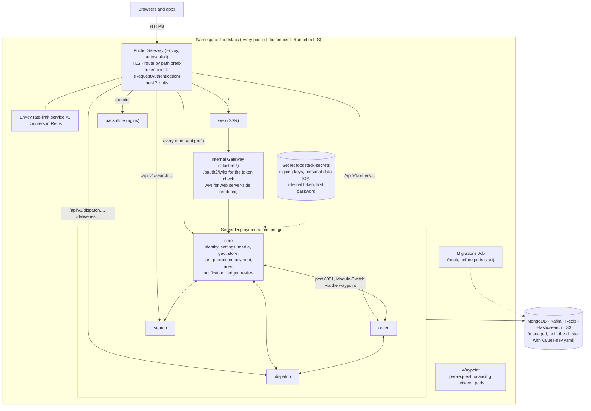
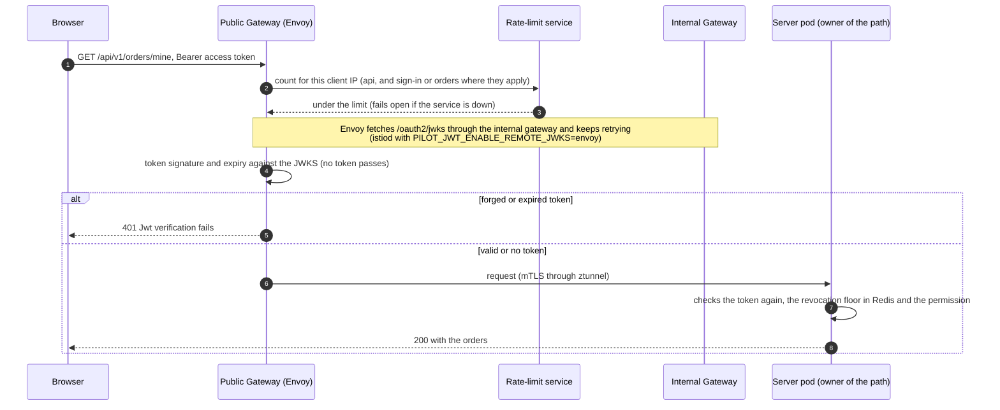
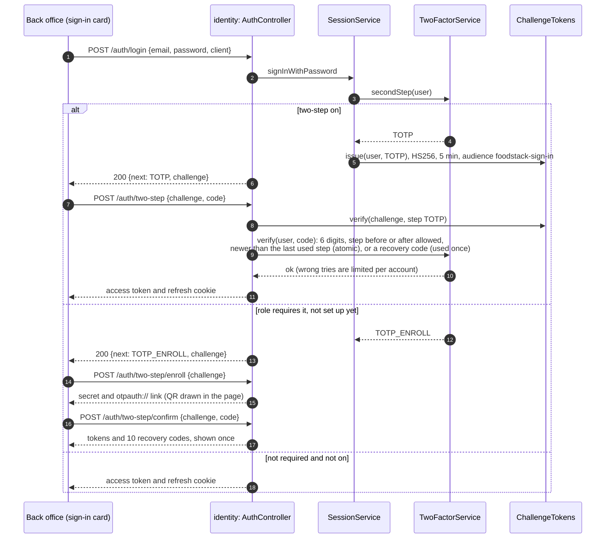
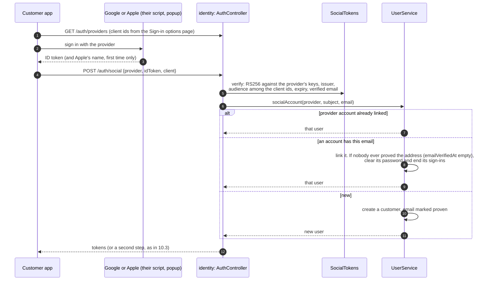
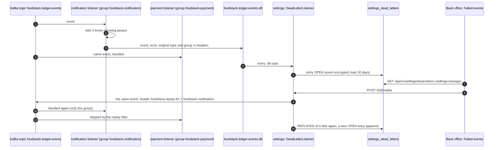
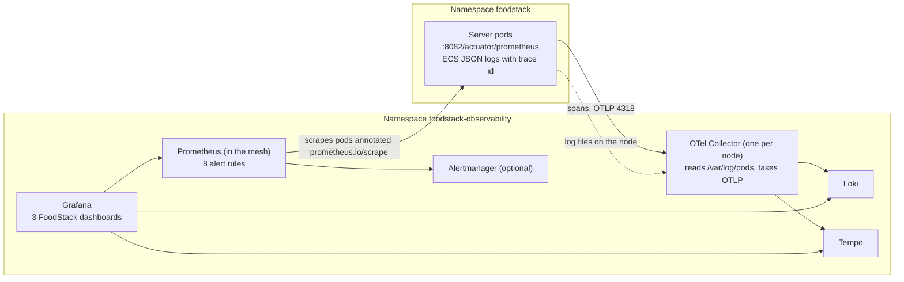

# 10. Kubernetes, sign-in security and failed events (M5)

[Back to index](README.md)

What the Helm chart installs and how a request crosses it, then the two sign-in flows M5 added (two-step and Google or Apple), the failed-events replay, and where metrics, logs and traces go. Traced from `k8s/helm/foodstack`, `k8s/helm/foodstack-observability`, the `identity` and `settings` modules and `platform-kafka`.

## 10.1 What the chart installs

Shown for `topology: split`. `monolith` has one `core` Deployment, `microservices` one per module, and `custom` whatever `server.deployments` lists. The chart writes the Module-Switch settings, the routes and the mesh policies for each one.

| Port on a server pod | Who may connect (AuthorizationPolicy, enforced by ztunnel) |
|---|---|
| 8080 public API | The two gateways, the web pod, other server pods, the waypoint |
| 8081 Module-Switch | Server pods and the waypoint only (plus the internal token) |
| 8082 health and metrics | Any pod in the mesh (Prometheus joins the mesh to scrape it) |

## 10.2 A signed-in request at the edge

## 10.3 Two-step sign-in with an authenticator app

Required for ADMIN and FINANCE (`foodstack.identity.totp.required-roles`); other back-office users may turn it on; customers do not have it. Every first step (password, emailed code, password reset, Google or Apple) ends the same way.

Later, on **Two-step sign-in** in the account menu, the user can get new recovery codes or turn it off (where the role allows), each with a current code. An administrator can reset it on the Users page, which ends all of that user's sign-ins.

## 10.4 Continue with Google or Apple

## 10.5 An event that keeps failing, and its replay

## 10.6 Metrics, logs and traces

