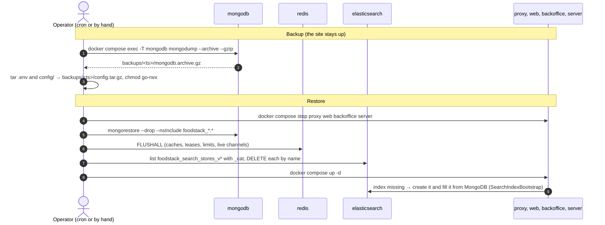
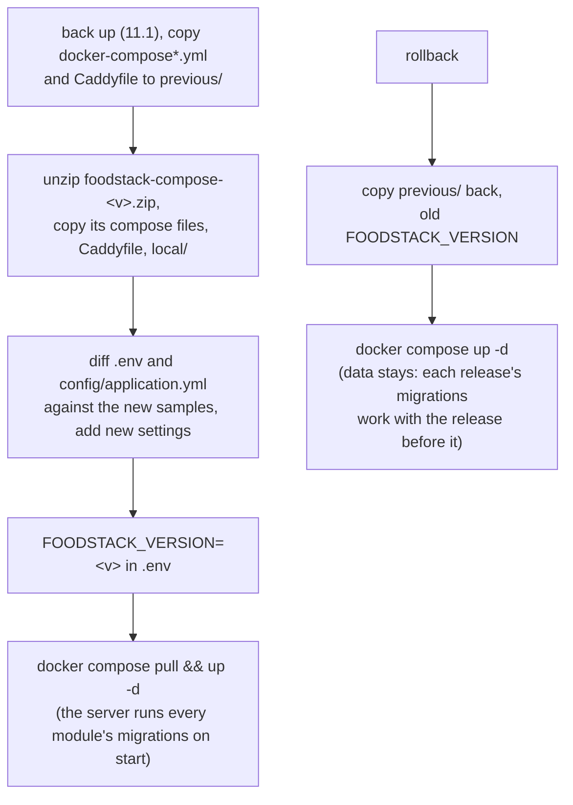
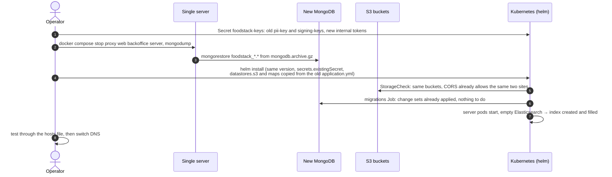
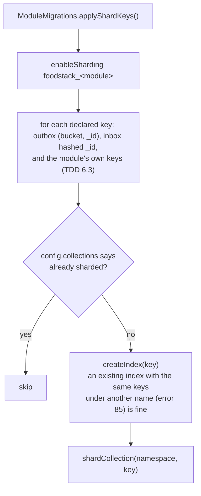
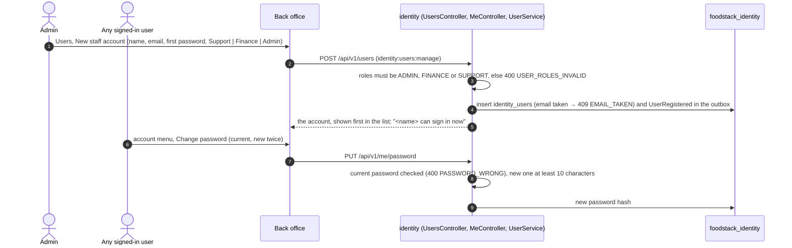

# 11. Running it: backups, upgrades, moves and staff accounts

[Back to index](README.md)

What the operator's tools do, traced from the Docker Compose commands in the handbook ([deploy/compose](../../deploy/compose/README.md)), the Helm chart's migrations job, `ModuleMigrations` and the back-office screens added in M6. The step-by-step guides that use them are the [Operator handbook](../handbook/README.md).

## 11.1 Backup and restore on one server

There are no scripts: the handbook ([guide 20](../handbook/20-backups.md)) gives plain `docker compose` commands, which a cron line runs nightly. A backup copies only what cannot be rebuilt and lives on the server: MongoDB and the two settings files. Photos and files are in the operator's own buckets (versioned at the provider). A restore puts MongoDB back and clears the copies that would otherwise be newer than the data.

- Kafka, Redis and Elasticsearch are never backed up: events wait in each module's outbox in MongoDB, Redis holds only short-lived copies, and the search index is rebuilt from the catalogue.
- Elasticsearch 9 refuses wildcard deletes (`action.destructive_requires_name`), so the restore lists the indices and deletes them one by one.
- On a new server the operator unpacks `config.tar.gz` before the first `docker compose up -d`. The old `.env` is safe to reuse there because the new MongoDB volume is empty and takes its password from it; `pii-key` and `signing-keys` come back with `config/application.yml` ([handbook 20](../handbook/20-backups.md)).
- A wrong `pii-key` stops the server at start: before making the first administrator, `BootstrapAdmin` decrypts the first administrator's stored email (`UserService.piiKeyOpensStoredData`) and throws if it cannot. Without this, the server started, could read no one's details, and made a second first administrator.

## 11.2 Upgrade and rollback on one server

On one machine there is one server, so it migrates as it starts. On Kubernetes, with many pods, a pre-upgrade hook Job runs every module's migrations with its own datastore override (`--foodstack.migrate-only=true`), then the Deployments roll.

## 11.3 Moving from one server to Kubernetes

The buckets stay where they are, so photos are not copied and stored image URLs stay valid. Image URLs are copied into brands, menu items and orders when they are written (`logoUrls`, `coverUrls` and the like), so a change of `foodstack.storage.public-base-url` (a CDN, handbook guide 49) needs the stored URLs rewritten. `tools/migrate/rewrite-media-urls.js` walks every document of every `foodstack_*` database, replaces strings that start with the old base, and keeps BSON types (dates, longs, decimals, ids) as they are.

The other moves (to separate services, regrouping, back) are in the [migration guide](../migration-guide.md).

## 11.4 Sharding a database that already has data

`datastores.mongodb.sharding: true` sets `FOODSTACK_MONGODB_SHARDING_ENABLED`, and every module's `ModuleMigrations` then applies its declared keys on start (the migrations Job, then each pod, which finds them done).

The index step is what lets a replica set with data become a sharded cluster: MongoDB creates the shard key's index by itself only for an empty collection. `ModuleMigrationsTest.shardsPopulatedCollection` covers it on the two-shard test cluster.

## 11.5 New staff account and Change password (back office)

Restaurant owners and riders are not made here: owners from a branch's **Managers** tab, riders from **Riders**.
