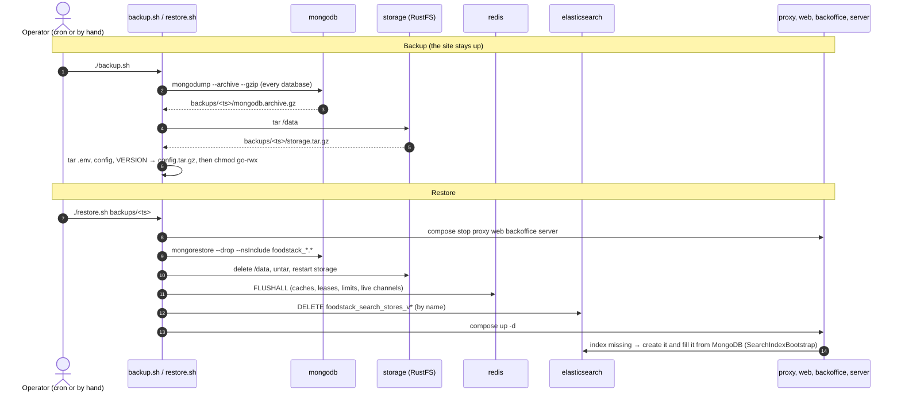
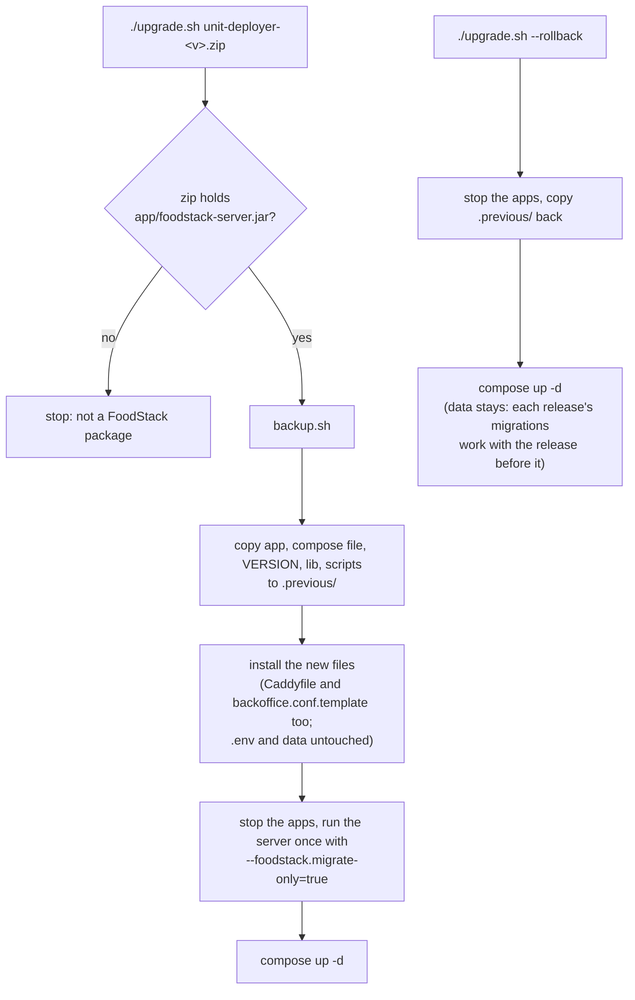
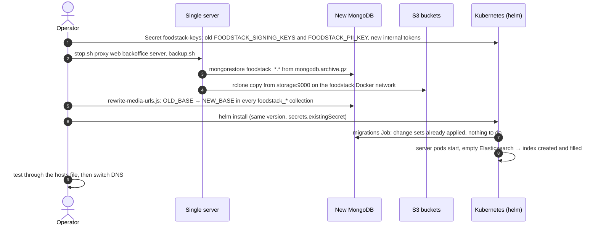
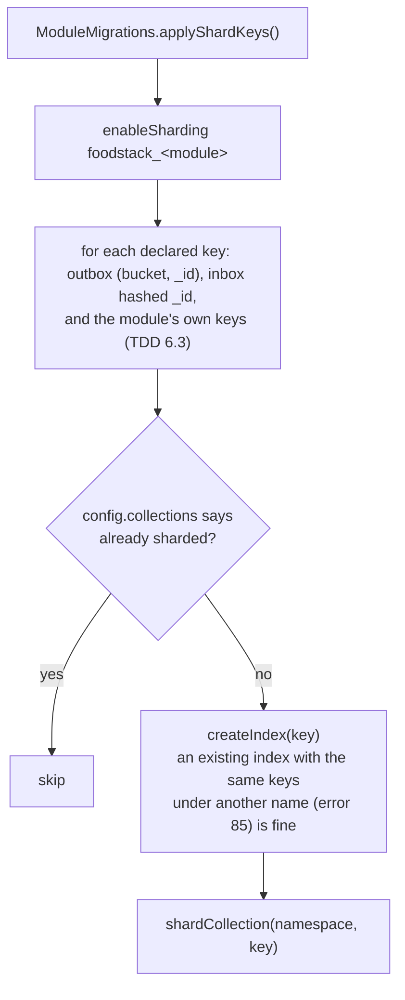
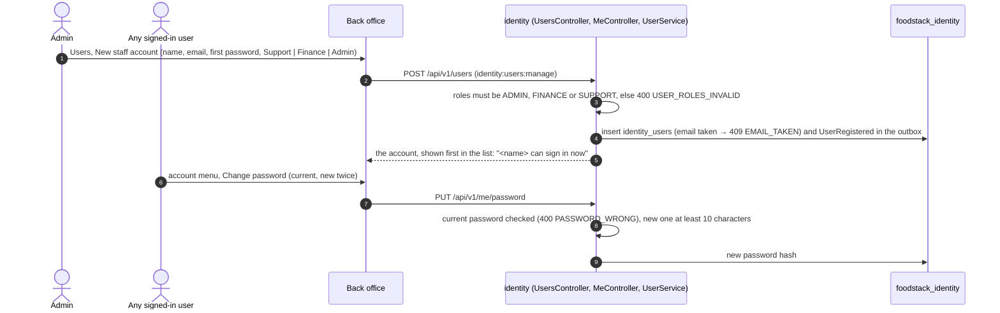

# 11. Running it: backups, upgrades, moves and staff accounts

[Back to index](README.md)

What the operator's tools do, traced from the unit deployer scripts (`deploy/unit-deployer/src/main/dist`), the Helm chart's migrations job, `ModuleMigrations` and the back-office screens added in M6. The step-by-step guides that use them are the [Operator handbook](../handbook/README.md).

## 11.1 Backup and restore on one server

`backup.sh` copies only what cannot be rebuilt. `restore.sh` puts it back and clears the copies that would otherwise be newer than the data.

- Kafka, Redis and Elasticsearch are never backed up: events wait in each module's outbox in MongoDB, Redis holds only short-lived copies, and the search index is rebuilt from the catalogue.
- `restore.sh` does not touch `.env`. On a new server the operator installs first, then copies only `FOODSTACK_PII_KEY` and `FOODSTACK_SIGNING_KEYS` from the old `.env`, because the new install's datastore passwords differ ([handbook 20](../handbook/20-backups.md)).
- A wrong `FOODSTACK_PII_KEY` stops the server at start: before making the first administrator, `BootstrapAdmin` decrypts the first administrator's stored email (`UserService.piiKeyOpensStoredData`) and throws if it cannot. Without this, the server started, could read no one's details, and made a second first administrator.

## 11.2 Upgrade and rollback on one server

On Kubernetes the same order holds: a pre-upgrade hook Job runs every module's migrations with its own datastore override, then the Deployments roll.

## 11.3 Moving from one server to Kubernetes

Image URLs are copied into brands, menu items and orders when they are written (`logoUrls`, `coverUrls` and the like), so a move of the photos also needs the stored URLs rewritten. `tools/migrate/rewrite-media-urls.js` walks every document of every `foodstack_*` database, replaces strings that start with the old base, and keeps BSON types (dates, longs, decimals, ids) as they are.

## 11.4 Sharding a database that already has data

`datastores.mongodb.sharding: true` sets `FOODSTACK_MONGODB_SHARDING_ENABLED`, and every module's `ModuleMigrations` then applies its declared keys on start (the migrations Job, then each pod, which finds them done).

The index step is what lets a replica set with data become a sharded cluster: MongoDB creates the shard key's index by itself only for an empty collection. `ModuleMigrationsTest.shardsPopulatedCollection` covers it on the two-shard test cluster.

## 11.5 New staff account and Change password (back office)

Restaurant owners and riders are not made here: owners from a branch's **Managers** tab, riders from **Riders**.
