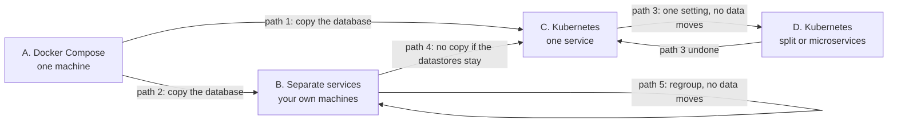

# FoodStack: Migration guide

How to move a running FoodStack from one setup to another. The code never changes: the same
version runs in every setup, and only where it runs and its settings change.

## The setups

| Setup | What runs | Settings live in | Guide |
|---|---|---|---|
| **A. Docker Compose** | One machine: every module in one server, with the datastores beside it | `.env`, `config/application.yml` | [deploy/compose](../deploy/compose/README.md) |
| **B. Separate services** | Your own machines, no Kubernetes: each module (or group of modules) is its own service | One `<module>.yml` per service, `Caddyfile` | [deploy/services](../deploy/services/README.md) |
| **C. Kubernetes, one service** | A cluster, every module in one Deployment (`topology: monolith`) | `my-values.yaml`, Secrets | [Kubernetes guide](kubernetes-guide.md) |
| **D. Kubernetes, split** | A cluster, modules in several Deployments (`split`, `microservices` or `custom`) | The same, plus `topology` | [Kubernetes guide 11](kubernetes-guide.md#11-choose-and-change-the-topology) |



## What always moves with you

Whatever the path, carry these over unchanged. Everything else can be new.

| What | Why | In A | In B | In C and D |
|---|---|---|---|---|
| Personal-data key | Without it, stored names, phones and addresses can't be read | `foodstack.security.pii-key` in `config/application.yml` | `pii-key` in every file | `FOODSTACK_PII_KEY` in the keys Secret |
| Token signing key | With the same key, nobody is signed out | `foodstack.identity.signing-keys` | `signing-keys` in `identity.yml` | `FOODSTACK_SIGNING_KEYS` in the keys Secret |
| The database | Orders, stores, accounts, money: everything | The `mongodb` container | Your MongoDB | Your MongoDB |
| The buckets | Every photo and file; they stay where they are, so nothing is copied | `foodstack.storage` | `media.yml` | `datastores.s3` |
| The version | Move first, upgrade after | `FOODSTACK_VERSION` in `.env` | the image tag | `--version` |
| Your addresses | Customers and staff keep using the same ones | `.env` | `Caddyfile`, `issuer` | `hosts` |
| `foodstack.kafka.topic-partitions` | Topics already made keep their partitions | `config/application.yml` (24) | every file | `datastores.kafka.topicPartitions` |

Redis, Kafka and Elasticsearch never need copying: Redis holds caches and sign-out checks, events
waiting for Kafka are kept in MongoDB until sent, and search fills itself from MongoDB.

### Where each setting goes

| Setting | A: `config/application.yml` | B: service files | C, D: `my-values.yaml` or a Secret |
|---|---|---|---|
| Public API address | `foodstack.security.issuer` | `issuer` in every file | `hosts.api` |
| Buckets | `foodstack.storage.*` | `media.yml` | `datastores.s3.*` |
| Address search, road distances | `foodstack.geo.*` | `geo.yml` | `maps.geocoding`, `maps.routing`; `GOOGLE_MAPS_API_KEY` in `foodstack-providers` |
| Map tiles | `MAP_TILE_*` in `.env` | `-e MAP_TILE_*` on the two apps | `maps.tiles` |
| Email | `spring.mail.*`, `foodstack.notification.*` | `notification.yml` | `SMTP_*` in `foodstack-providers` |
| Push | `foodstack.notification.push.*` | `notification.yml` | `FCM_*` in `foodstack-providers` |
| Card payments | `foodstack.payment.*` | `payment.yml` | `PAYMENT_GATEWAY` in `server.env`, `STRIPE_*` in `foodstack-providers` |
| First administrator | `foodstack.identity.bootstrap-admin` | `identity.yml` | `secrets.adminEmail`, `FOODSTACK_ADMIN_PASSWORD` (only on a new install) |

---

## Path 1: Docker Compose to Kubernetes

Follow [handbook runbook 40](handbook/40-move-to-kubernetes.md): it has every command. In short:

1. Prepare the cluster and the datastores (managed ones are easiest).
2. Make the keys Secret with the **same** `pii-key` and `signing-keys` as `config/application.yml`,
   and write `my-values.yaml` with the same buckets, maps and addresses (table above).
3. Maintenance window: `docker compose stop proxy web backoffice server`, back up MongoDB
   ([deploy/compose](../deploy/compose/README.md#back-up)), and `mongorestore` that backup into the
   new MongoDB.
4. `helm install` the **same version**. Test through your hosts file, then switch DNS.
5. Keep the old machine stopped but intact for a week.

About 30 to 60 minutes offline.

## Path 2: Docker Compose to separate services

For when one machine is too small but you don't want Kubernetes. You run the same server program
once per module (or per group of modules) on your own machines, with a proxy in front.

**You need:** MongoDB (a replica set), Redis, Kafka and Elasticsearch reachable from every machine
(managed services are easiest); the machines for the services; the files in
[deploy/services](../deploy/services/README.md). About 30 to 60 minutes offline.

### Prepare (no downtime)

1. **Choose the groups.** Fifteen services is a lot to watch. A good start is four: `order`,
   `dispatch` and `search` on their own, and `core` for the rest
   ([grouping](../deploy/services/README.md#group-modules-into-fewer-services)).
2. **Fill in the files** from your `config/application.yml`:
   - `pii-key` and `signing-keys`: the **same** values (copy them, don't make new ones);
   - the datastore addresses: your new datastores;
   - `foodstack.storage` into `media.yml`, `foodstack.geo` into `geo.yml`, email and push into
     `notification.yml`, payments into `payment.yml`, `foodstack.order.web-url` into `order.yml`;
   - new values for the internal token and the service client secret (`openssl rand -hex 24`),
     the same in every file;
   - every `*.internal` address: where you will run each service.
3. **The proxy:** fill in `Caddyfile` with the same addresses.
4. **Lower the DNS time to live** to 5 minutes a day ahead, so the switch is quick.

### The maintenance window

5. On the old machine, stop the apps and back up:
   ```bash
   docker compose stop proxy web backoffice server
   docker compose exec -T mongodb sh -c 'mongodump --quiet --archive --gzip -u foodstack -p "$MONGO_INITDB_ROOT_PASSWORD" --authenticationDatabase admin' > final.archive.gz
   ```
6. Copy the database into the new MongoDB:
   ```bash
   docker run --rm -i mongo:8.2 mongorestore --uri '<new MongoDB connection string>' \
     --archive --gzip --nsInclude 'foodstack_*.*' --drop < final.archive.gz
   ```
7. Start the `identity` service (or the group that has it) first, then the others, then the two
   apps and the proxy ([start order](../deploy/services/README.md#start-it)). Use the **same version**.
8. Test through your hosts file (point your three names at the proxy's address), sign in, place a
   test order. Then switch DNS to the proxy machine.

### Check it worked

- Every service answers `{"status":"UP"}` on `curl -s localhost:8080/actuator/health/readiness`.
- You sign in with your existing password; past orders and stores are there; photos show.
- A test order goes from placed to collected, and its emails show as sent in the **Email log**.

**Undo:** before the DNS switch, `docker compose up -d` on the old machine brings it back as it was.
After it, orders placed on the new setup are not on the old machine: note them first.

## Path 3: Kubernetes, one service to split or microservices

One setting, **no data moves, no downtime**. Follow [handbook runbook 42](handbook/42-split-modules.md):

```yaml
# my-values.yaml
topology: split          # or microservices, or custom with your own groups
```

```bash
helm upgrade foodstack oci://ghcr.io/ilyaslabs/charts/foodstack --version <your version> -n foodstack -f my-values.yaml
```

The new Deployments start; once they're ready, each module's requests go to its own Deployment.
Undo: `topology: monolith` and the same upgrade.

## Path 4: Separate services to Kubernetes

If your datastores are managed services the cluster can reach, **nothing is copied**: the cluster
uses the same MongoDB, Redis, Kafka and Elasticsearch.

1. Write `my-values.yaml` with the same datastores, buckets, maps and addresses, and the keys
   Secret with the same `pii-key`, `signing-keys`, internal token and service client secret as
   your service files. Pick the `topology` that matches your groups (or `custom` with the same groups).
2. Maintenance window: stop every service and the two apps (the datastores keep running).
3. `helm install` the **same version** (no `mongorestore`: the data is already there). Test
   through your hosts file, then switch DNS to the cluster's Gateway.

If your datastores were on your own machines and the cluster can't reach them, copy MongoDB as in
path 1 instead.

## Path 5: Regroup separate services

Moving a module from one service to another (for example taking `order` out of `core`), or
merging services. **No data moves**: each module's data is in its own database, whoever runs it.

1. Start the new service with its file, with the module set to `{ mode: local }` and listed under
   `expose.modules`.
2. Point the other services' `url` for that module, and its routes in `Caddyfile`, at the new
   service. Restart them one at a time (`docker restart <name>`) and reload Caddy
   (`docker exec proxy caddy reload --config /etc/caddy/Caddyfile`).
3. In the old service's file, set the module to `{ mode: http, url: … }`, take it out of
   `expose.modules`, and restart it.

Requests to the module during the change are retried, so nothing is lost.

## A module's own database

Any setup can give one module its own MongoDB cluster (for example `payment` and `ledger` for
audits): set `foodstack.modules.<module>.mongodb.uri` in that module's settings, after copying its
`foodstack_<module>` database. Step by step on Kubernetes: [handbook runbook 45](handbook/45-module-database.md).
